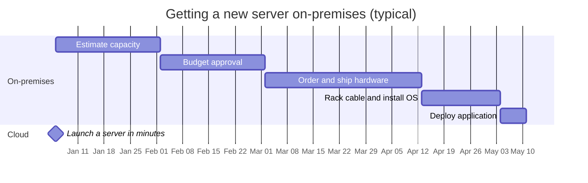
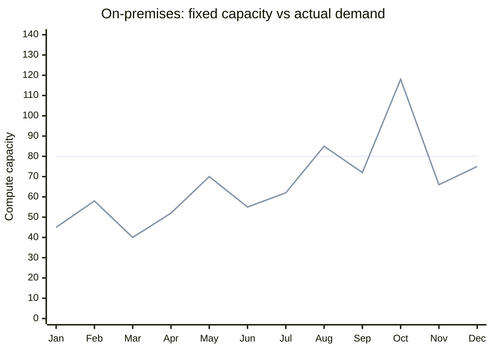
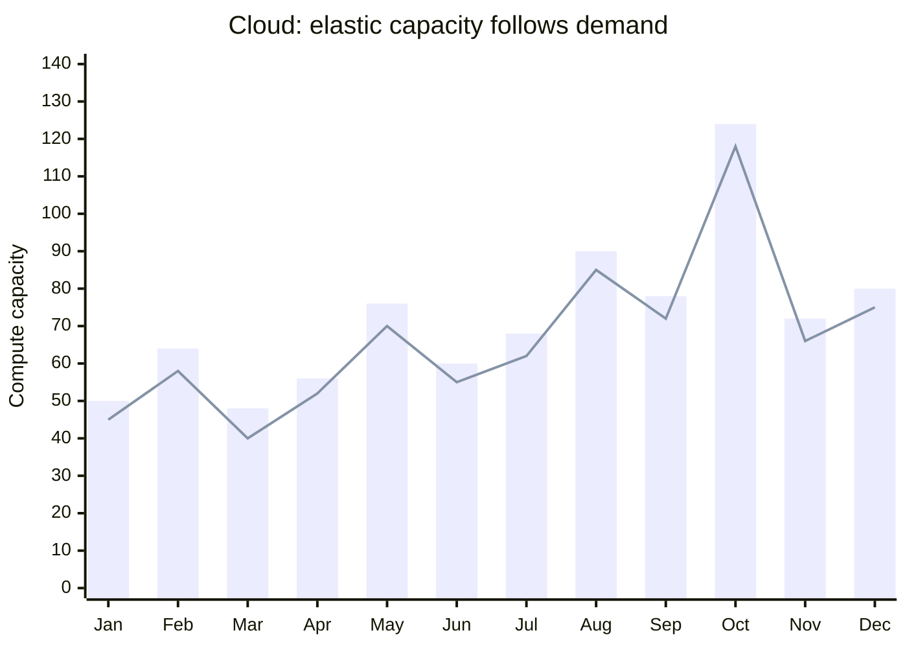
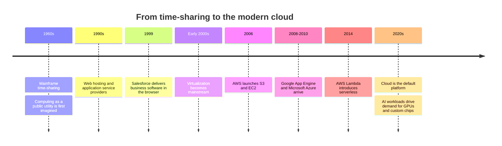
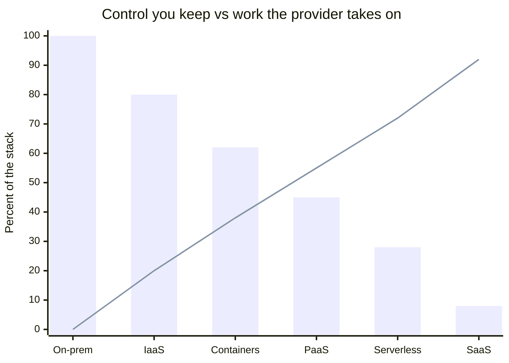
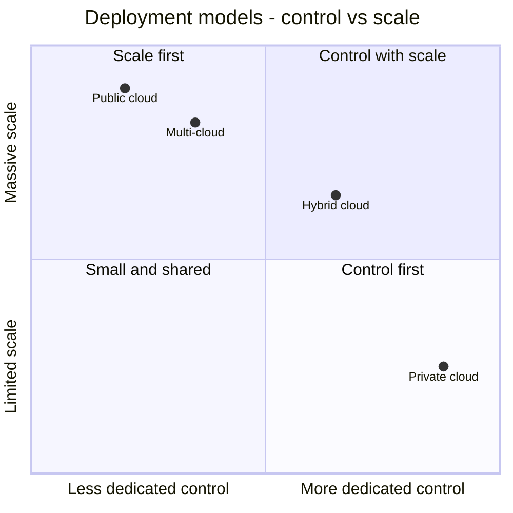
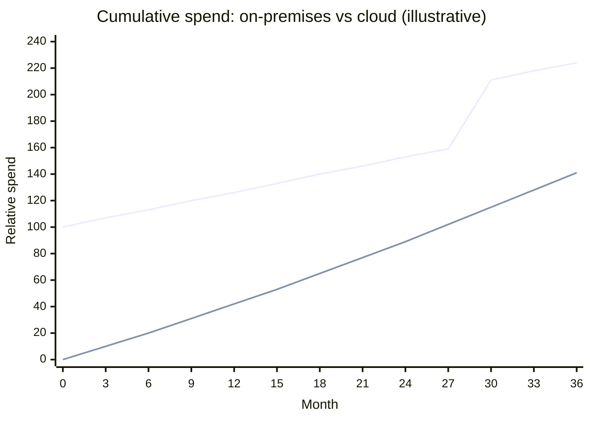
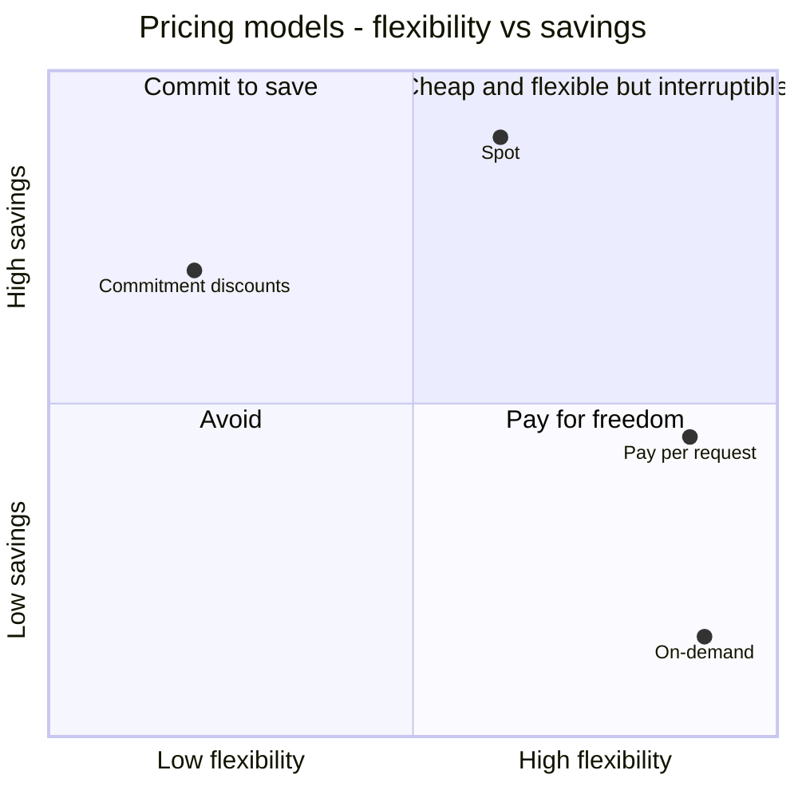
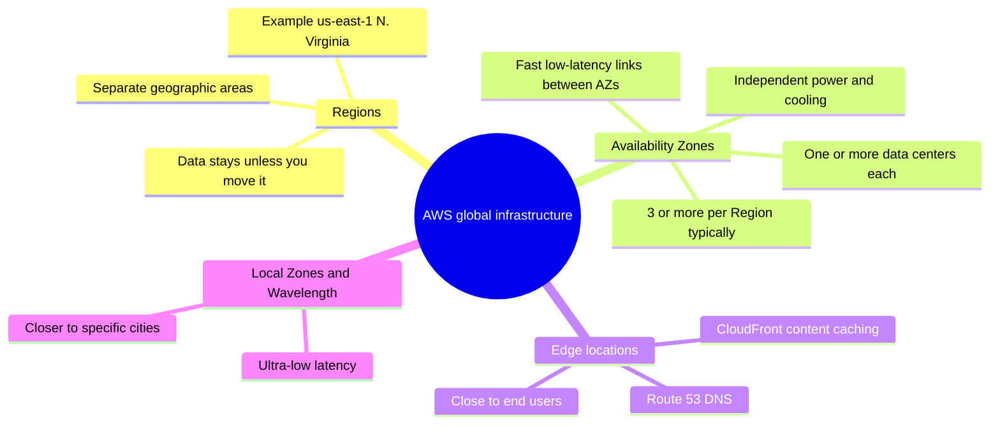
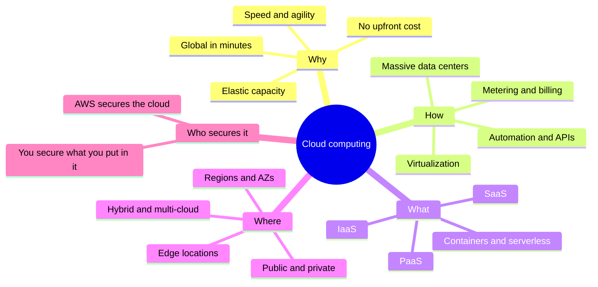

# ☁️ Day 1 — Introduction to Cloud Computing

> [!NOTE]
> **Goal of today:** understand what cloud computing really is, why it exists, how it works under the hood, and the core models every AWS topic builds on.

---

## 📑 Contents

1. [What is cloud computing?](#1-what-is-cloud-computing)
2. [Why the cloud exists](#2-why-the-cloud-exists)
3. [A short history](#3-a-short-history)
4. [How the cloud works under the hood](#4-how-the-cloud-works-under-the-hood)
5. [The five essential characteristics](#5-the-five-essential-characteristics)
6. [Service models — IaaS, PaaS, SaaS](#6-service-models--iaas-paas-saas)
7. [Deployment models](#7-deployment-models)
8. [The economics of the cloud](#8-the-economics-of-the-cloud)
9. [The shared responsibility model](#9-the-shared-responsibility-model)
10. [AWS global infrastructure](#10-aws-global-infrastructure)
11. [Scaling and availability](#11-scaling-and-availability)
12. [Benefits and challenges](#12-benefits-and-challenges)
13. [The big picture](#13-the-big-picture)

---

## 1. What is cloud computing?

**Cloud computing is the on-demand delivery of computing resources — servers, storage, databases, networking and software — over the internet, with pay-as-you-go pricing.**

Instead of buying and maintaining your own hardware, you **rent** capacity from a provider such as AWS. You get it in minutes through a web console or an API call, and when you no longer need it, you hand it back and stop paying.

### ⚡ The electricity analogy

| | 🏭 Electricity | ☁️ Cloud computing |
|---|---|---|
| **You don't build…** | a power plant | a data center |
| **You simply…** | plug in and draw power | call an API and get servers |
| **You pay for…** | kWh used | seconds, GB, requests used |
| **The provider handles…** | generation and the grid | hardware, power, cooling, network |

> [!TIP]
> "The cloud" is not something in the sky. It is **someone else's very large, highly automated data centers**, offered to you as a service.

---

## 2. Why the cloud exists

Before the cloud, launching an application meant running it **on-premises** — in your own server room. Getting a single new server looked like this:

### The problems with traditional IT

| Problem | What it looks like |
|---|---|
| 💰 **Huge upfront cost** | Servers, licences, power, cooling and space — paid before you know if the product succeeds |
| 🎯 **Capacity guessing** | Too little → outages. Too much → expensive machines sit idle |
| 🐢 **Slow** | Months between "we need a server" and having one |
| 📉 **Low utilization** | Servers often use a small fraction of their capacity — but you pay for all of it |
| 🔧 **Undifferentiated heavy lifting** | Engineers fix hardware instead of improving the product |
| 🌍 **Hard to go global** | New continent = new data center |

### 📈 The capacity-guessing problem

**On-premises:** you buy a fixed amount of capacity (the flat line) while real demand (the wavy line) goes up and down.

- Every month demand is **below** the flat line, you are **paying for idle servers**.
- In October demand **spikes above** it — your site slows down or crashes and you **lose customers**.

**Cloud:** capacity (bars) is added and removed automatically, so it follows demand (line) closely.

---

## 3. A short history

> [!NOTE]
> Amazon built massive, reliable infrastructure for its own retail business — then realized other companies needed exactly the same thing. That became AWS.

---

## 4. How the cloud works under the hood

Four technologies make the cloud possible. Think of them as a stack, from the building up to you:

| Layer | What happens here |
|---|---|
| 👩‍💻 **You** | Click in the console, run a CLI command, or call an SDK → every action is an **API request** |
| 🎛️ **Control plane** | Authenticates you, finds free capacity, configures it, starts metering and billing |
| 🟧🟪🟩 **Virtual machines** | Your VM runs next to other customers' VMs, fully isolated (🟧 you · 🟪 customer B · 🟩 customer C) |
| 🧩 **Hypervisor** | Software (AWS **Nitro**) that splits one physical server into many VMs |
| 🖥️ **Physical servers** | Powerful machines with many CPU cores, lots of RAM, fast networking |
| 🏢 **Data center** | Power, cooling, physical security, global network |

### 4.1 Massive data centers
Providers run enormous fleets of servers across many locations worldwide, with redundant power, cooling and networking.

### 4.2 Virtualization
A **hypervisor** divides one physical server into many isolated **virtual machines (VMs)**. Each VM behaves like its own computer with its own operating system. This gives:
- **High utilization** — hardware is shared efficiently
- **Isolation** — customers cannot see or affect each other
- **Speed** — a new VM is just software, ready in minutes

> [!TIP]
> AWS's **Nitro System** moves networking, storage and security work onto dedicated hardware cards, so almost all of the server's power goes to your instance.

### 4.3 Multi-tenancy and resource pooling
Many customers ("tenants") share the same physical infrastructure, securely separated. Because millions of customers rarely peak at the same moment, the provider can keep utilization high and prices low.

### 4.4 Automation and APIs
Every action is an API call. That means infrastructure can be **written as code** (*Infrastructure as Code* — e.g., AWS CloudFormation, Terraform) and created the same way every time.

### 4.5 Metering and billing
Everything is measured — compute-seconds, GB stored, GB transferred, requests — and billed automatically.

---

## 5. The five essential characteristics

The U.S. National Institute of Standards and Technology (**NIST SP 800-145**) defines cloud computing. A service is truly "cloud" only if it has **all five**:

| # | Characteristic | Meaning | AWS example |
|:-:|---|---|---|
| 1️⃣ | **On-demand self-service** | Get resources yourself — no tickets, no waiting for people | Launch an EC2 instance in minutes |
| 2️⃣ | **Broad network access** | Available over the network from any device | Console, CLI, SDKs, mobile app |
| 3️⃣ | **Resource pooling** | Shared infrastructure, dynamically assigned to customers | Multi-tenant hosts in AWS data centers |
| 4️⃣ | **Rapid elasticity** | Scale out and in quickly; capacity seems unlimited | EC2 Auto Scaling, S3 grows automatically |
| 5️⃣ | **Measured service** | Usage is metered and you pay for what you use | Per-second EC2 billing, per-GB S3 billing |

> [!IMPORTANT]
> **Scalability** = the *ability* to handle more load.
> **Elasticity** = doing it *automatically*, **both up and down**, in step with demand.

---

## 6. Service models — IaaS, PaaS, SaaS

Service models answer one question: **how much does the provider manage for you?**

### 🟦🟧 Who manages what

🟦 = **You manage** 🟧 = **Provider manages**

| Layer | On-premises | IaaS | PaaS | SaaS |
|---|:-:|:-:|:-:|:-:|
| Applications | 🟦 | 🟦 | 🟦 | 🟧 |
| Data | 🟦 | 🟦 | 🟦 | 🟦\* |
| Runtime | 🟦 | 🟦 | 🟧 | 🟧 |
| Middleware | 🟦 | 🟦 | 🟧 | 🟧 |
| Operating system | 🟦 | 🟦 | 🟧 | 🟧 |
| Virtualization | 🟦 | 🟧 | 🟧 | 🟧 |
| Servers | 🟦 | 🟧 | 🟧 | 🟧 |
| Storage | 🟦 | 🟧 | 🟧 | 🟧 |
| Networking | 🟦 | 🟧 | 🟧 | 🟧 |

\* Even with SaaS, **your data and who can access it** remain your responsibility.

### 🏗️ IaaS — Infrastructure as a Service
You rent raw building blocks: virtual servers, storage, networks. You manage the OS and everything above it.
- **Most control**, most responsibility
- **AWS:** Amazon EC2, Amazon EBS, Amazon VPC
- **Use when:** you need full control, or are moving existing servers to the cloud ("lift and shift")

### 🧰 PaaS — Platform as a Service
You bring your code and data; the provider runs the OS, runtime, patching and scaling.
- **Less to manage**, faster development
- **AWS:** AWS Elastic Beanstalk, Amazon RDS, AWS App Runner
- **Use when:** developers want to focus on the app, not servers

### 📦 SaaS — Software as a Service
A finished application delivered over the internet. You just use it.
- **Nothing to manage** except users and data
- **Examples:** Gmail, Microsoft 365, Salesforce, Zoom

### ➕ Beyond the big three

| Model | Idea | AWS example |
|---|---|---|
| **Containers as a Service** | Run containers without managing the orchestration platform | Amazon ECS, Amazon EKS, AWS Fargate |
| **Serverless / FaaS** | Upload functions, pay per request — no servers to manage at all | AWS Lambda |

### 🍕 The pizza analogy

| | 🏠 Homemade (On-prem) | 🛒 Take & bake (IaaS) | 🛵 Delivery (PaaS) | 🍽️ Dine out (SaaS) |
|---|:-:|:-:|:-:|:-:|
| Kitchen & oven | 🟦 | 🟦 | 🟧 | 🟧 |
| Dough & toppings | 🟦 | 🟧 | 🟧 | 🟧 |
| Baking | 🟦 | 🟦 | 🟧 | 🟧 |
| Table & serving | 🟦 | 🟦 | 🟦 | 🟧 |

### ⚖️ Control vs convenience

Bars show **how much of the stack you still manage** (%). The line shows **how much the provider takes over**. (Illustrative.)

Moving right: **less operational work, faster delivery, finer billing — but less control and customization.**

---

## 7. Deployment models

Deployment models describe **where the cloud runs and who it serves**.

| Model | What it is | 👍 Pros | 👎 Cons |
|---|---|---|---|
| 🌐 **Public cloud** | Provider-owned infrastructure shared by many customers (AWS, Azure, Google Cloud) | No upfront cost, massive scale, global, huge service catalogue | Must manage cost and configuration carefully |
| 🔒 **Private cloud** | Cloud-style infrastructure dedicated to one organization, usually on-premises | Full control, meets strict compliance | Expensive, you buy and run hardware, limited scale |
| 🔗 **Hybrid cloud** | On-premises + public cloud connected and used together | Gradual migration, keep sensitive systems local, burst to the cloud | More complex networking and operations |
| 🧩 **Multi-cloud** | Using more than one public cloud provider | Best service per need, less vendor dependence | Multiple skill sets, harder governance |

> [!TIP]
> AWS hybrid tools: **AWS Direct Connect** (private dedicated link to AWS), **AWS Site-to-Site VPN** (encrypted tunnel), and **AWS Outposts** (AWS hardware installed in your own data center).

---

## 8. The economics of the cloud

### 8.1 CapEx vs OpEx

| | 🏦 **CapEx** — Capital Expenditure | 🧾 **OpEx** — Operational Expenditure |
|---|---|---|
| Model | Buy assets upfront | Pay as you use |
| Example | Purchasing servers | Monthly cloud bill |
| Risk | High — money spent before value is proven | Low — stop paying when you stop using |
| Flexibility | Locked in for years | Change any time |

**Cumulative spend over three years** (illustrative shape, relative units). The first line is **on-premises**: a big purchase on day one, running costs, and a hardware refresh around month 30. The second line is **cloud**: spend grows gradually with usage.

### 8.2 AWS's six advantages of cloud computing

| # | Advantage | In plain words |
|:-:|---|---|
| 1 | 💸 **Trade fixed expense for variable expense** | Pay only for what you consume |
| 2 | 🏭 **Benefit from massive economies of scale** | AWS's huge scale lowers prices for everyone |
| 3 | 🎯 **Stop guessing capacity** | Scale with real demand |
| 4 | 🚀 **Increase speed and agility** | Resources in minutes; experiments are cheap |
| 5 | 🧹 **Stop spending money running data centers** | Focus on your customers, not hardware |
| 6 | 🌍 **Go global in minutes** | Deploy close to users worldwide |

### 8.3 Pricing models

| Model | How it works | Best for |
|---|---|---|
| ⏱️ **On-demand** | Pay per second/hour, no commitment | Unpredictable or short-term workloads |
| 📅 **Commitment discounts** (Savings Plans, Reserved Instances) | Commit to steady usage for 1 or 3 years for a big discount | Predictable, always-on workloads |
| 🎲 **Spot** | Spare capacity at a deep discount; can be reclaimed at short notice | Flexible, interruptible batch jobs |
| 📨 **Pay per request** | Billed per request, GB or execution time | Serverless and storage |
| 🎁 **Free tier** | Limited free usage for learning | Beginners (check current AWS Free Tier terms) |

### 8.4 Total Cost of Ownership (TCO)

Comparing on-prem to cloud is **not** "server price vs instance price".

| On-premises TCO includes | Cloud TCO includes |
|---|---|
| Hardware and software licences | Usage charges |
| Power, cooling, floor space | **Data transfer out** of AWS |
| Network equipment | Support plans |
| Staff time, maintenance, repairs | Time spent managing and optimizing spend |
| Hardware refresh every 3–5 years | — |
| Idle capacity you paid for anyway | — |

> [!WARNING]
> The cloud makes it **easy to spend money**. Idle resources, oversized instances and forgotten test environments are the most common causes of surprise bills. Managing cloud cost (**FinOps**) is a core skill.

---

## 9. The shared responsibility model

Security in the cloud is **shared** between AWS and you.

| ☁️ AWS — security **OF** the cloud | 👤 You — security **IN** the cloud |
|---|---|
| Physical data centers and hardware | Your data |
| Global network infrastructure | Identity and access (IAM): who can do what |
| Virtualization layer (hypervisor) | OS patches and apps (on EC2) |
| Infrastructure of managed services | Network and firewall rules (security groups) |
| | Encryption choices |

### 🟦🟧 The line moves with the service

🟦 = **You** 🟧 = **AWS**

| Layer | Amazon EC2 (IaaS) | Amazon RDS (managed DB) | AWS Lambda (serverless) | Amazon S3 (storage) |
|---|:-:|:-:|:-:|:-:|
| Data & access (IAM) | 🟦 | 🟦 | 🟦 | 🟦 |
| Application / code | 🟦 | 🟦 | 🟦 | 🟧 |
| Runtime / DB engine | 🟦 | 🟧 | 🟧 | 🟧 |
| Operating system | 🟦 | 🟧 | 🟧 | 🟧 |
| Virtualization | 🟧 | 🟧 | 🟧 | 🟧 |
| Physical hardware | 🟧 | 🟧 | 🟧 | 🟧 |
| Data center facilities | 🟧 | 🟧 | 🟧 | 🟧 |

> [!CAUTION]
> Most cloud security incidents come from **customer misconfiguration** — public storage buckets, overly broad permissions, leaked access keys — not from AWS's infrastructure. **You always own your data and who can access it.**

---

## 10. AWS global infrastructure

| Concept | What it is | Why it matters |
|---|---|---|
| 🗺️ **Region** | A geographic area containing multiple isolated Availability Zones | Data residency, latency, service availability, price |
| 🏢 **Availability Zone (AZ)** | One or more data centers with independent power, cooling and networking, linked to other AZs by fast private connections | Run across **multiple AZs** for high availability |
| 📍 **Edge location** | Small sites near users for caching (CloudFront) and DNS (Route 53) | Lower latency for end users |

### How to choose a Region

| Order | Factor | Question to ask |
|:-:|---|---|
| 1 | ⚖️ **Compliance** | Are there laws about where this data must live? |
| 2 | ⚡ **Latency** | Which Region is closest to my users? |
| 3 | 🧰 **Service availability** | Is every service I need offered there? |
| 4 | 💲 **Price** | Costs differ between Regions |

---

## 11. Scaling and availability

### ↕️ Vertical vs ↔️ horizontal scaling

| | ↕️ **Vertical — scale UP** | ↔️ **Horizontal — scale OUT** |
|---|---|---|
| Picture | 🖥️ ➜ 🖥️🔼 one bigger machine | 🖥️ ➜ 🖥️🖥️🖥️🖥️ more machines behind a load balancer |
| Limit | Largest available instance | Practically none |
| Downtime | Often needs a restart | None if designed well |
| Failure | Still a single point of failure | One failure barely matters |
| AWS | Change the EC2 instance type | Auto Scaling + Elastic Load Balancing |

> [!TIP]
> **Horizontal scaling is the cloud-native way.** Design apps so any single server can disappear without users noticing.

### 🕒 What the "nines" mean

| Availability | Max downtime per year | Visual |
|---|---|---|
| 99% | ≈ 3.65 days | 🟥🟥🟥🟥🟥🟥🟥🟥🟥🟥 |
| 99.9% | ≈ 8.77 hours | 🟧🟧🟧🟧🟧🟧🟧 |
| 99.99% | ≈ 52.6 minutes | 🟨🟨🟨🟨 |
| 99.999% | ≈ 5.26 minutes | 🟩 |

Each extra nine cuts allowed downtime by **10×** — and raises cost and complexity.

### Key vocabulary

| Term | Meaning |
|---|---|
| **High availability** | Staying up despite component failures (e.g., multiple AZs) |
| **Fault tolerance** | Continuing with **no** interruption when something fails |
| **Durability** | How unlikely it is that stored data is lost (S3 is designed for 99.999999999% — "11 nines") |
| **Disaster recovery** | Restoring service after a major failure |
| **RPO** | Recovery Point Objective — how much data loss is acceptable |
| **RTO** | Recovery Time Objective — how long you can be down |
| **Managed service** | Provider handles patching, backups and scaling for you |
| **Vendor lock-in** | Depending on one provider's services so heavily that switching is hard |

> [!NOTE]
> "Everything fails, all the time." — Werner Vogels, Amazon CTO. Cloud architecture **assumes failure** and designs around it.

---

## 12. Benefits and challenges

| ✅ Benefits | ⚠️ Challenges |
|---|---|
| **Agility** — idea to infrastructure in minutes | **Cost control** — easy to overspend without monitoring |
| **Elasticity** — capacity matches demand | **Misconfiguration** — the customer side of security is where most breaches happen |
| **No upfront investment** | **Vendor lock-in** — proprietary services are hard to leave |
| **Global reach** | **Compliance & data sovereignty** — laws about where data lives |
| **Reliability** — multi-AZ designs that are hard to build alone | **Network dependence** — everything relies on connectivity |
| **Security at scale** — heavy provider investment and certifications | **Skills gap** — new knowledge in architecture, security, automation, cost |
| **Innovation** — instant access to databases, analytics, AI/ML | **Outages still happen** — you must design for failure |

### The major providers

| Provider | Launched | Known for |
|---|---|---|
| 🟧 **Amazon Web Services (AWS)** | 2006 | The pioneer; broadest and deepest service catalogue |
| 🟦 **Microsoft Azure** | 2010 | Enterprise and Microsoft-ecosystem integration |
| 🟩 **Google Cloud** | 2008 | Data analytics, Kubernetes, AI/ML |

The core ideas — compute, storage, networking, IAM, Regions, shared responsibility — are **the same everywhere**. Learn AWS well, and the others become much easier.

---

## 13. The big picture

### 🎯 Key takeaways

1. Cloud computing is **renting computing resources over the internet, on demand, pay-as-you-go**.
2. It solves the **cost, speed and capacity-guessing** problems of running your own data centers.
3. It's powered by **data centers + virtualization + APIs/automation + metering**.
4. NIST's five characteristics: **self-service, broad access, pooling, elasticity, measured service**.
5. **IaaS → PaaS → SaaS** trade control for convenience.
6. **Public, private, hybrid, multi-cloud** describe where it runs.
7. Security is **shared** — AWS secures the cloud; **you** secure what you put in it.
8. **Regions and Availability Zones** let you build fast, compliant, highly available systems.

> [!IMPORTANT]
> **One-line summary:** *The cloud turns infrastructure into software — something you request with an API call, scale automatically, and pay for only while you use it.*
