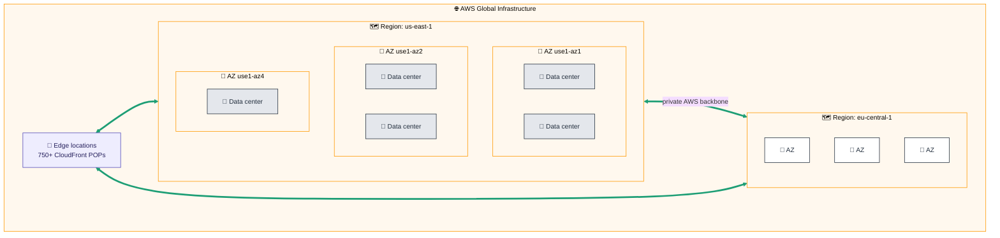
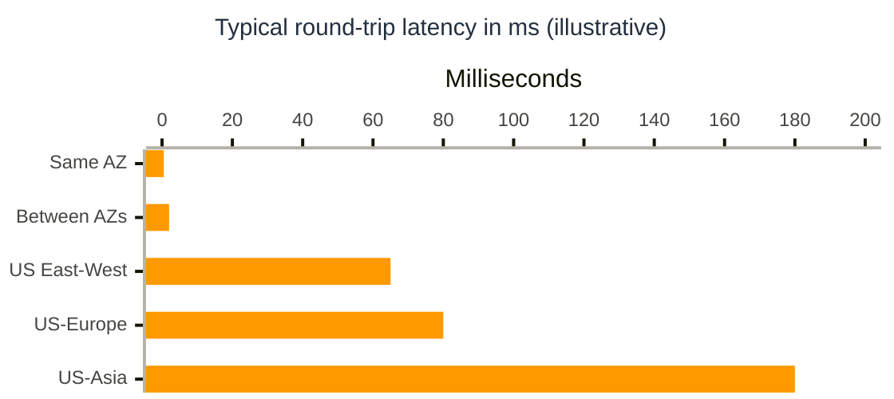
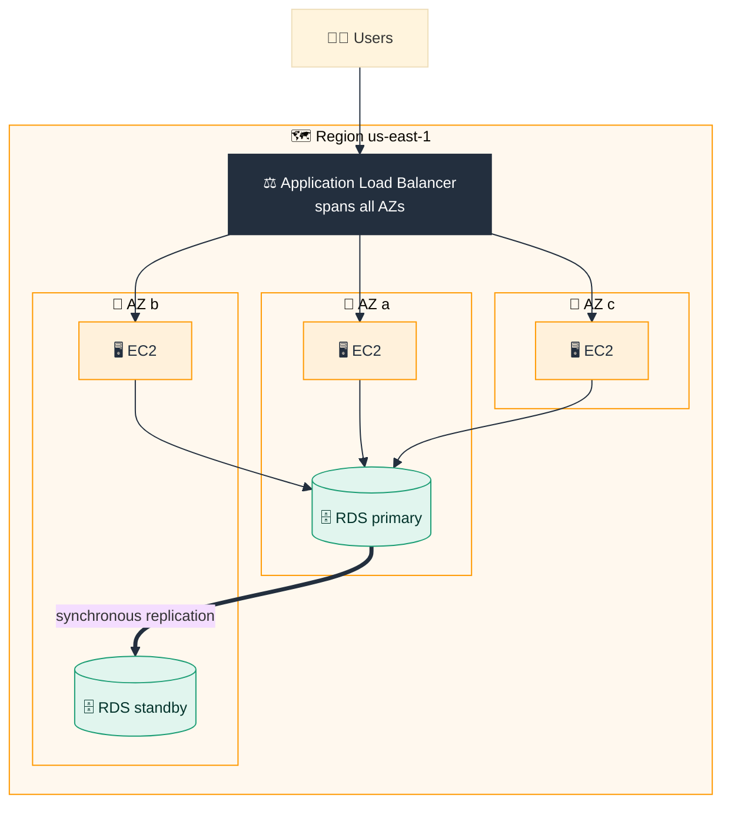
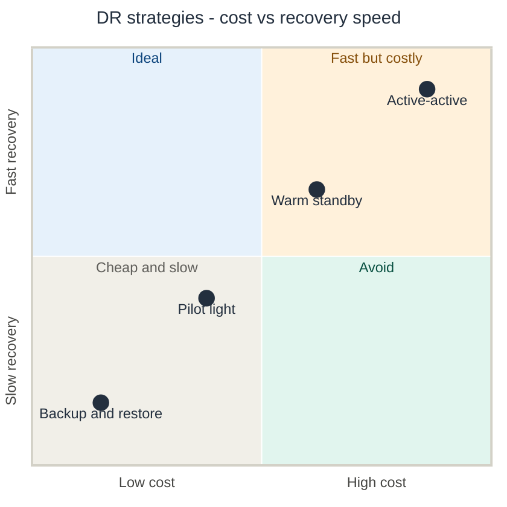
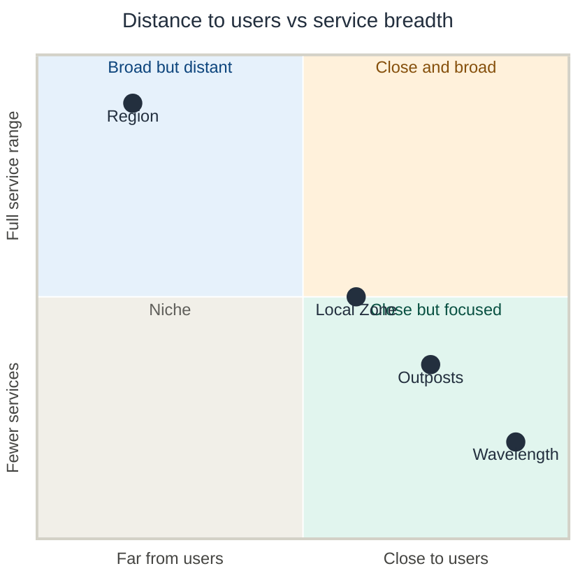

# 🌍 Day 2 — AWS Global Infrastructure

> [!NOTE]
> **Goal:** understand *where* AWS physically runs your workloads — Regions, Availability Zones, edge locations and the newer extension zones — and how to use that geography to build systems that are **fast, compliant and highly available**.

> [!IMPORTANT]
> Figures in these notes reflect AWS's published numbers as of **November 2026**. AWS adds Regions and zones frequently — always check the official [AWS Global Infrastructure](https://aws.amazon.com/about-aws/global-infrastructure/) page for the latest.

---

## 📑 Contents

1. [What is the AWS global infrastructure?](#1-what-is-the-aws-global-infrastructure)
2. [The footprint in numbers](#2-the-footprint-in-numbers)
3. [Regions](#3-regions)
4. [Availability Zones](#4-availability-zones)
5. [Data centers](#5-data-centers)
6. [Designing for failure: single-AZ, multi-AZ, multi-Region](#6-designing-for-failure-single-az-multi-az-multi-region)
7. [The edge network](#7-the-edge-network)
8. [Extending AWS closer to users: Local Zones, Wavelength, Outposts](#8-extending-aws-closer-to-users-local-zones-wavelength-outposts)
9. [The AWS global network backbone](#9-the-aws-global-network-backbone)
10. [Service scope: global, regional and zonal services](#10-service-scope-global-regional-and-zonal-services)
11. [How to choose a Region](#11-how-to-choose-a-region)
12. [The big picture](#12-the-big-picture)

---

## 1. What is the AWS global infrastructure?

The **AWS global infrastructure** is the worldwide network of physical facilities and networking that every AWS service runs on. It is organized as a **hierarchy**, from large geographic areas down to individual buildings, plus a layer of smaller sites that sit close to end users.


### The hierarchy at a glance



| Level | Size | What it is | What it protects you from |
|---|---|---|---|
| 🌐 **AWS global** | Worldwide | All Regions, edge sites and the private network | — |
| 🗺️ **Region** | A metro / geographic area | A cluster of 3+ Availability Zones | Region-wide events, legal & data-residency issues |
| 🏢 **Availability Zone** | Within ~100 km of the other AZs | One or more data centers with independent power, cooling, networking | Building failures, power/network outages, fires, floods |
| 🧱 **Data center** | A building | Thousands of servers | Individual server/rack failures |
| 📍 **Edge location** | Near users in cities worldwide | Caching and DNS sites | Latency for end users |

> [!TIP]
> Remember the chain: **Region ⊃ Availability Zones ⊃ Data centers**. Edge locations sit *outside* this chain, close to users.

---

## 2. The footprint in numbers

<table>
<tr>
<td align="center" width="25%"><h1>39</h1>🗺️ <b>Regions</b></td>
<td align="center" width="25%"><h1>123</h1>🏢 <b>Availability Zones</b></td>
<td align="center" width="25%"><h1>750+</h1>📍 <b>CloudFront POPs</b></td>
<td align="center" width="25%"><h1>15</h1>🗄️ <b>Regional edge caches</b></td>
</tr>
<tr>
<td align="center"><h1>43</h1>🏙️ <b>Local Zones</b></td>
<td align="center"><h1>33</h1>📶 <b>Wavelength Zones</b></td>
<td align="center"><h1>~20M km</h1>🧵 <b>Backbone fiber</b></td>
<td align="center"><h1>+2 · +7</h1>🔜 <b>Regions · AZs announced</b><br><sub>Saudi Arabia, Chile</sub></td>
</tr>
</table>

<sub>AWS published figures, November 2026.</sub>

### Growth over time

| | ~2021 | Mar 2025 | Nov 2026 |
|---|---|---|---|
| 🗺️ **Regions** | `▰▰▰▰▰▰▱▱▱▱` 25 | `▰▰▰▰▰▰▰▰▰▱` 36 | `▰▰▰▰▰▰▰▰▰▰` **39** |
| 🏢 **Availability Zones** | `▰▰▰▰▰▰▰▱▱▱` 81 | `▰▰▰▰▰▰▰▰▰▱` 114 | `▰▰▰▰▰▰▰▰▰▰` **123** |

> [!NOTE]
> On average a Region holds about **3 AZs** (123 ÷ 39 ≈ 3.2) — matching AWS's rule of **at least three AZs per Region**.

---

## 3. Regions

### 3.1 What is a Region?

A **Region** is a physical location in the world where AWS clusters data centers. Each Region:

- Contains **at least three** isolated, physically separate **Availability Zones**
- Is **completely independent** of other Regions — separate power, networking, and control systems for most services
- Keeps your data **inside it** unless you explicitly copy or move it elsewhere

> [!IMPORTANT]
> **Regions are isolated by design.** A problem in one Region should not spread to another. This is what makes a Region a strong **fault isolation boundary** and what lets you meet **data-residency** laws.

### 3.2 Region naming

Every Region has a **code** you use in the console, CLI, SDKs and ARNs.

```
  us  -  east  -  1
  │       │       └── Number: order of the Region in that area
  │       └────────── Direction / sub-area
  └────────────────── Geographic area
```

| Region code | Name | Region code | Name |
|---|---|---|---|
| `us-east-1` | US East (N. Virginia) | `eu-central-1` | Europe (Frankfurt) |
| `us-east-2` | US East (Ohio) | `eu-west-1` | Europe (Ireland) |
| `us-west-2` | US West (Oregon) | `eu-west-2` | Europe (London) |
| `ca-central-1` | Canada (Central) | `ap-south-1` | Asia Pacific (Mumbai) |
| `sa-east-1` | South America (São Paulo) | `ap-southeast-1` | Asia Pacific (Singapore) |
| `af-south-1` | Africa (Cape Town) | `ap-northeast-1` | Asia Pacific (Tokyo) |
| `me-south-1` | Middle East (Bahrain) | `ap-southeast-2` | Asia Pacific (Sydney) |

> [!NOTE]
> `us-east-1` (N. Virginia) was AWS's **first Region (2006)**. It is the largest, usually gets new services first, and hosts the control plane for some global services — but it is also the busiest, so don't put everything there by default.

### 3.3 A short history of Region expansion

| Year | 🗺️ Region milestone |
|:--:|---|
| **2006** | 🟧 **US East (N. Virginia)** — the very first Region |
| **2008** | 🇮🇪 Europe (Ireland) — first outside the US |
| **2010–11** | Singapore · Tokyo · Oregon · São Paulo · **GovCloud (US)** |
| **2014** | Frankfurt · China (Beijing, via a local partner) |
| **2016** | Mumbai · Seoul · Ohio · Canada · London |
| **2019–20** | Hong Kong · Bahrain · Cape Town · Milan |
| **2022–23** | UAE · Zurich · Spain · Hyderabad · Melbourne · Israel · Calgary |
| **2025–26** | Mexico · Thailand · Taipei · New Zealand · 🇪🇺 **European Sovereign Cloud** |

### 3.4 Special Region partitions

Most Regions belong to the standard **`aws` partition**. A few are deliberately separated for legal or sovereignty reasons, with **separate accounts and credentials**:

| Partition | Who it's for | Key point |
|---|---|---|
| 🌐 **Standard AWS** | Everyone | All the normal commercial Regions |
| 🏛️ **AWS GovCloud (US)** | US government agencies and regulated industries | Operated by US persons on US soil; supports strict compliance regimes |
| 🇨🇳 **AWS China** | Customers operating in mainland China | Operated by local Chinese partners; separate from global AWS |
| 🇪🇺 **AWS European Sovereign Cloud** | EU public sector and regulated industries | Physically and logically separate cloud located and operated within the EU |

---

## 4. Availability Zones

### 4.1 What is an Availability Zone?

An **Availability Zone (AZ)** is **one or more discrete data centers** with **redundant power, networking and connectivity**, inside a Region.

| Property | Detail |
|---|---|
| 🏗️ **Physically separate** | Each AZ is a meaningful distance — many kilometers — from the others, to avoid shared risks like fire, flood or power-grid failure |
| 📏 **But close** | All AZs in a Region are within **~100 km (60 miles)** of each other |
| ⚡ **Fast links** | Connected by redundant, dedicated metro fiber with **single-digit millisecond** latency |
| 🔁 **Synchronous replication** | Low enough latency to copy data to another AZ **before** confirming a write (e.g., RDS Multi-AZ) |
| 🔌 **Independent** | Own power, cooling, networking — and AWS staggers software deployments across AZs so one bad update doesn't hit all of them |

### 4.2 Latency: why AZ distance is a sweet spot



- **Same AZ:** typically sub-millisecond — fastest, but no protection from an AZ failure.
- **Between AZs:** single-digit ms — fast enough to behave like one system, far enough to survive a building-level disaster.
- **Between Regions:** tens to hundreds of ms — physics (speed of light in fiber) makes **synchronous** replication impractical, so cross-Region copies are usually **asynchronous**.

### 4.3 AZ names vs AZ IDs

AZ **names** like `us-east-1a` are **mapped differently for each AWS account**, so that customers don't all pile into the same physical "a" zone.

| Identifier | Example | Same physical zone across accounts? |
|---|---|:-:|
| **AZ name** | `us-east-1a` | ❌ No — mapping is per account |
| **AZ ID** | `use1-az1` | ✅ Yes — consistent everywhere |

> [!TIP]
> When coordinating resources across multiple AWS accounts (e.g., shared VPC subnets or matching latency-sensitive workloads), use the **AZ ID**, not the name.

### 4.4 The cost side of AZs

> [!WARNING]
> Traffic **inside one AZ** is usually free on private IPs, but data transferred **between AZs** in a Region is typically **charged in both directions**. Multi-AZ designs are essential for availability — just be aware that chatty cross-AZ traffic adds cost and a little latency.

---

## 5. Data centers

An AZ is made of one or more **data centers**. AWS doesn't let you choose or see individual buildings — the AZ is the smallest location you design around.

| Area of a data center | Purpose |
|---|---|
| 🖥️ Servers and storage | Run EC2 instances, store EBS and S3 data |
| 🔌 Power | Utility feeds, batteries, backup generators |
| ❄️ Cooling | Removing heat from dense racks |
| 🌐 Networking | High-speed switches and links to other AZs and the backbone |
| 🛡️ Physical security | Perimeter controls, guards, biometric access, cameras, strict media destruction |

> [!NOTE]
> AWS designs its own servers, network equipment and chips (e.g., **Nitro**, **Graviton**, **Trainium**, **Inferentia**). Owning the whole stack lets it control performance, security and cost.

---

## 6. Designing for failure: single-AZ, multi-AZ, multi-Region

"Everything fails, all the time." The question is **how big a failure you need to survive**.

### 🧯 Which failures does each design survive?

| Failure scenario | 1️⃣ Single AZ | 2️⃣ Multi-AZ (one Region) | 3️⃣ Multi-Region |
|---|:-:|:-:|:-:|
| A single server dies | ✅ (if you have spares) | ✅ | ✅ |
| A rack or network switch fails | ⚠️ | ✅ | ✅ |
| A whole data center loses power | ❌ | ✅ | ✅ |
| An entire Availability Zone goes down | ❌ | ✅ | ✅ |
| A Region-wide service disruption | ❌ | ❌ | ✅ |
| Need to serve users on several continents quickly | ❌ | ❌ | ✅ |
| Legal need to keep copies in two countries | ❌ | ❌ | ✅ |

### 💲 The trade-off

| | Single AZ | Multi-AZ | Multi-Region |
|---|:-:|:-:|:-:|
| Availability | 🟥 Low | 🟩 High | 🟩🟩 Highest |
| Cost | 🟩 Lowest | 🟨 Moderate | 🟥 Highest |
| Complexity | 🟩 Simple | 🟨 Moderate | 🟥 Complex |
| Typical use | Dev/test, batch | **Most production workloads** | Mission-critical, global, strict DR |

> [!IMPORTANT]
> AWS's Well-Architected Framework recommends running **all production workloads in at least two Availability Zones**. A production system in a single AZ is a classic anti-pattern.

### A typical multi-AZ architecture



If **AZ a** fails: the load balancer stops sending traffic there, Auto Scaling launches replacement instances in the healthy AZs, and RDS **fails over** to the standby in AZ b — usually within minutes, with no data loss.

### Services that do multi-AZ for you

| Service | Built-in AZ resilience |
|---|---|
| **Amazon S3** (Standard) | Stores data redundantly across a minimum of 3 AZs automatically |
| **Amazon DynamoDB** | Replicates data across multiple AZs automatically |
| **Amazon RDS Multi-AZ** | Keeps a synchronous standby in another AZ with automatic failover |
| **Elastic Load Balancing** | Spreads traffic across instances in multiple AZs |
| **EC2 Auto Scaling** | Balances instances across the AZs you choose and replaces failed ones |
| **AWS Lambda** | Runs functions across multiple AZs in a Region |

### Multi-Region strategies (disaster recovery)



| Strategy | What runs in the second Region | Recovery time |
|---|---|---|
| 🗃️ **Backup & restore** | Only backups | Hours |
| 🔥 **Pilot light** | Core data replicated; servers off until needed | Tens of minutes |
| 🌡️ **Warm standby** | A scaled-down but running copy | Minutes |
| ⚖️ **Multi-site active/active** | Full copy serving live traffic | Near zero |

---

## 7. The edge network

Regions are where your applications **run**. The **edge network** is how content and requests get to and from users **quickly**.

### 7.1 Edge components

| Component | Count | Role |
|---|---|---|
| 📍 **CloudFront points of presence (POPs)** | 750+ | Cache content close to users; terminate connections nearby |
| 🗄️ **Regional edge caches** | 15 | A larger mid-tier cache between POPs and your origin, holding less-popular content longer |
| 🧭 **Amazon Route 53** | Runs on the edge | DNS — answers "what IP is this name?" from a nearby location |
| 🚀 **AWS Global Accelerator** | Uses the edge | Gives fixed anycast IPs and routes traffic onto the AWS backbone at the nearest edge |
| 🛡️ **AWS Shield / AWS WAF** | At the edge | DDoS protection and web filtering before traffic reaches your app |

### 7.2 How a CloudFront request is served

| Step | 🟩 Cache hit (fast path) | 🟧 Cache miss (first request) |
|:-:|---|---|
| 1 | User in Chicago requests `image.jpg` | User in Chicago requests `image.jpg` |
| 2 | 📍 Nearby CloudFront POP already has it | 📍 POP doesn't have it → asks 🗄️ regional edge cache |
| 3 | ✅ Returned in a few ms | Regional cache doesn't have it → fetches from 🏠 origin (e.g. S3 in `us-east-1`) over the AWS backbone |
| 4 | — | Object is stored at the regional cache **and** the POP |
| 5 | — | ✅ Returned to the user — the **next** user nearby gets a cache hit |

> [!TIP]
> **Edge locations don't run your EC2 instances** — they cache and route. Your application still lives in a Region. (Small pieces of logic *can* run at the edge using CloudFront Functions and Lambda@Edge.)

---

## 8. Extending AWS closer to users: Local Zones, Wavelength, Outposts

Sometimes even the nearest Region is too far — for real-time gaming, live video, factory systems, or data that legally must stay on-site. AWS offers **extensions** of a Region.

| Option | Where it is | Managed by | Best for |
|---|---|---|---|
| 🏙️ **Local Zones** (43) | AWS infrastructure in a large city, attached to a parent Region | AWS | Single-digit ms latency to users in that metro (media rendering, gaming, live streaming) |
| 📶 **Wavelength Zones** (33) | Inside telecom providers' **5G networks** | AWS + telecom partner | Ultra-low latency for mobile and connected devices (AR/VR, connected vehicles) |
| 🏭 **AWS Outposts** | **Your own data center** or site | AWS (installed and maintained by AWS) | Workloads that must stay on-premises for latency, local processing or data residency |
| 🔐 **Dedicated Local Zones** | Customer- or community-specific locations | AWS | Governments/regulated sectors needing exclusive, sovereign infrastructure |



> [!NOTE]
> Local Zones, Wavelength Zones and Outposts are all **anchored to a parent Region** — they are managed through that Region and connect back to it.

---

## 9. The AWS global network backbone

All AWS Regions and edge sites are linked by AWS's own **private global network**:

| Fact | Detail |
|---|---|
| 🧵 **Scale** | Roughly **20 million km** of fiber-optic cabling, including undersea cables |
| 🔒 **Private** | Traffic between AWS Regions travels on the AWS backbone rather than the public internet |
| 🔐 **Encrypted** | Traffic between AWS facilities on the backbone is encrypted |
| 🔁 **Redundant** | Multiple paths so a cut cable doesn't isolate a Region |

Why it matters:

- **Inter-Region replication** (S3 Cross-Region Replication, DynamoDB global tables, Aurora Global Database) runs over this backbone.
- **CloudFront** and **Global Accelerator** pull user traffic onto the backbone at the nearest edge, avoiding the slower, less predictable public internet for most of the journey.

---

## 10. Service scope: global, regional and zonal services

Not every AWS service lives at the same level. Knowing the scope tells you **where a resource exists** and **what failure can affect it**.

| Scope | Meaning | Examples |
|---|---|---|
| 🌐 **Global** | One service for all Regions; you don't pick a Region | **IAM**, **Route 53**, **CloudFront**, **AWS Organizations** |
| 🗺️ **Regional** | Resources live in one Region and are spread across its AZs by AWS | **S3** buckets, **DynamoDB** tables, **Lambda**, **VPC**, **SQS**, **Elastic Load Balancing** |
| 🏢 **Zonal** | Resources live in **one specific AZ** — you must place copies in other AZs yourself | **EC2 instances**, **EBS volumes**, **VPC subnets**, a single-AZ RDS instance |

> [!CAUTION]
> An **EBS volume** exists in one AZ and can only attach to EC2 instances **in that same AZ**. To move data elsewhere, take a **snapshot** (stored regionally) and create a new volume from it.

> [!TIP]
> S3 bucket **names** are globally unique, but each bucket's **data lives in the Region you choose**. The S3 console looks "global", but the service is regional.

---

## 11. How to choose a Region

Work through these factors **in order**:

| Order | Factor | Question to ask | Example |
|:-:|---|---|---|
| 1 | ⚖️ **Compliance & data residency** | Do laws or contracts require data to stay in a country or region? | EU customer data → an EU Region or the European Sovereign Cloud |
| 2 | ⚡ **Latency to users** | Which Region is closest to most of my users? | Users in India → `ap-south-1` (Mumbai) |
| 3 | 🧰 **Service & feature availability** | Does this Region offer every service and instance type I need? | New services often launch in `us-east-1` first |
| 4 | 💲 **Pricing** | How do prices compare? Prices differ by Region | The same instance type can cost noticeably more in some Regions |
| 5 | 🌱 **Sustainability** (optional) | Do I have carbon or energy goals? | Some Regions run on more renewable energy |

> [!TIP]
> AWS provides a **Capabilities by Region** tool to compare which services, features and APIs are available in each Region before you commit.

---

## 12. The big picture

| 🗺️ Regions | 🏢 Availability Zones | 📍 Edge network | 🏙️ Extensions | 🧵 Backbone |
|---|---|---|---|---|
| **39** launched | **123** worldwide | **750+** CloudFront POPs | Local Zones (**43**) | ~**20M km** fiber |
| Isolated from each other | **3+** per Region | **15** regional edge caches | Wavelength (**33**) | Private network |
| Data residency boundary | Within ~**100 km** | Route 53 DNS | Outposts (on-prem) | Encrypted between sites |
| Pick by compliance → latency → services → price | Single-digit ms links → **multi-AZ** for production | Global Accelerator · Shield · WAF | Anchored to a parent Region | Carries cross-Region replication |

### 🎯 Key takeaways

1. AWS infrastructure is a hierarchy: **Regions ⊃ Availability Zones ⊃ data centers**, plus an **edge network** near users.
2. **Regions** are isolated geographic areas — the unit for **data residency** and large-scale fault isolation.
3. Each Region has **at least three AZs**, physically separate but within ~100 km, linked with **single-digit ms** latency.
4. **Multi-AZ** is the baseline for production; **multi-Region** is for global reach and disaster recovery.
5. The **edge network** (CloudFront, Route 53, Global Accelerator) makes applications fast for users everywhere.
6. **Local Zones, Wavelength Zones and Outposts** extend AWS into cities, 5G networks and your own buildings.
7. Know each service's **scope** — global, regional or zonal — to know what can fail and where data lives.
8. Choose a Region by **compliance → latency → service availability → price**.

> [!IMPORTANT]
> **One-line summary:** *Pick the right Region for your users and laws, spread your app across multiple Availability Zones, and use the edge to bring it close to everyone.*

---

## 📚 References

All diagrams, charts, tables and analogies in these notes were created for these notes. No external images are used. The facts and ideas come from these sources:

| # | Source | What was taken from it |
|:-:|---|---|
| 1 | [AWS Global Infrastructure](https://aws.amazon.com/about-aws/global-infrastructure/) | Region, AZ, CloudFront POP, regional edge cache, Local Zone and Wavelength Zone counts; ~20 million km backbone fiber; 3+ AZs per Region |
| 2 | [AWS Regions and Availability Zones](https://aws.amazon.com/about-aws/global-infrastructure/regions_az/) | Region and AZ definitions; AZs within 100 km (60 miles) of each other; announced Regions (Saudi Arabia, Chile) |
| 3 | [AWS Fault Isolation Boundaries whitepaper — Availability Zones](https://docs.aws.amazon.com/whitepapers/latest/aws-fault-isolation-boundaries/availability-zones.html) | AZ separation, single-digit ms synchronous replication, staggered deployments, dedicated metro fiber |
| 4 | [AWS Well-Architected Framework — REL10-BP01](https://docs.aws.amazon.com/wellarchitected/latest/framework/rel_fault_isolation_multiaz_region_system) | Run production in at least two AZs; single-AZ as an anti-pattern |
| 5 | [Disaster Recovery of Workloads on AWS whitepaper](https://docs.aws.amazon.com/whitepapers/latest/disaster-recovery-workloads-on-aws/disaster-recovery-options-in-the-cloud.html) | Backup & restore, pilot light, warm standby, multi-site active/active |
| 6 | [Amazon CloudFront Developer Guide — How CloudFront delivers content](https://docs.aws.amazon.com/AmazonCloudFront/latest/DeveloperGuide/HowCloudFrontWorks.html) | Cache hit/miss flow through POPs and regional edge caches |
| 7 | [AWS RAM User Guide — Availability Zone IDs](https://docs.aws.amazon.com/ram/latest/userguide/working-with-az-ids.html) | AZ names vs AZ IDs |
| 8 | [AWS Local Zones](https://aws.amazon.com/about-aws/global-infrastructure/localzones/) · [AWS Wavelength](https://aws.amazon.com/wavelength/) · [AWS Outposts](https://aws.amazon.com/outposts/) | Extension zone descriptions and use cases |
| 9 | [AWS Architecture Blog — Availability Zone affinity](https://aws.amazon.com/blogs/architecture/improving-performance-and-reducing-cost-using-availability-zone-affinity) | Sub-ms latency in one AZ, single-digit ms between AZs, cross-AZ transfer cost |
| 10 | [AWS News Blog — Regions](https://aws.amazon.com/blogs/aws/category/regions) | 114 AZs / 36 Regions (March 2025); Taipei Region launch |
| 11 | [BMC Blog — AWS Regions & Availability Zones](https://www.bmc.com/blogs/aws-regions-availability-zones/) | Earlier footprint (81 AZs / 25 Regions) used for the growth comparison |

> [!NOTE]
> The latency figures between Regions and the positions on the quadrant charts are **illustrative approximations** made for learning, not official AWS numbers.
