# 🚀 Launch Your First Linux EC2 Instance & Connect to It

> **Goal:** Launch a Linux server on AWS EC2, then connect to it in six different ways.
> **Track:** AWS Cloud · EC2 basics

---

## 📑 Contents

1. [The Big Picture](#-the-big-picture)
2. [Part A: Launching the Instance](#-part-a--launching-the-instance)
3. [Part B: Connecting to the Instance](#-part-b--connecting-to-the-instance)
4. [Troubleshooting](#-troubleshooting-cheat-sheet)
5. [Quick Revision](#-quick-revision)

---

## 🗺️ The Big Picture

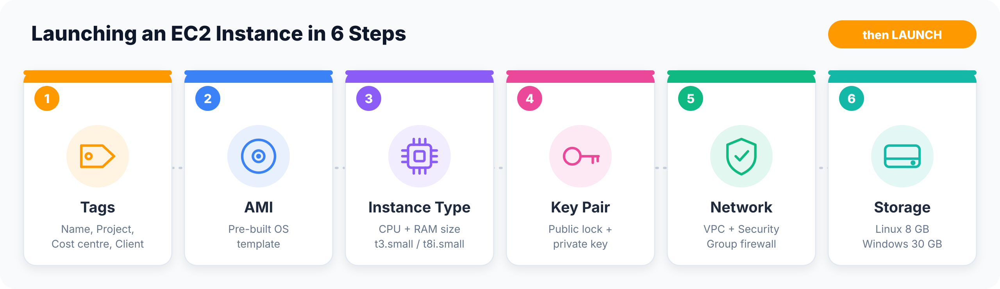

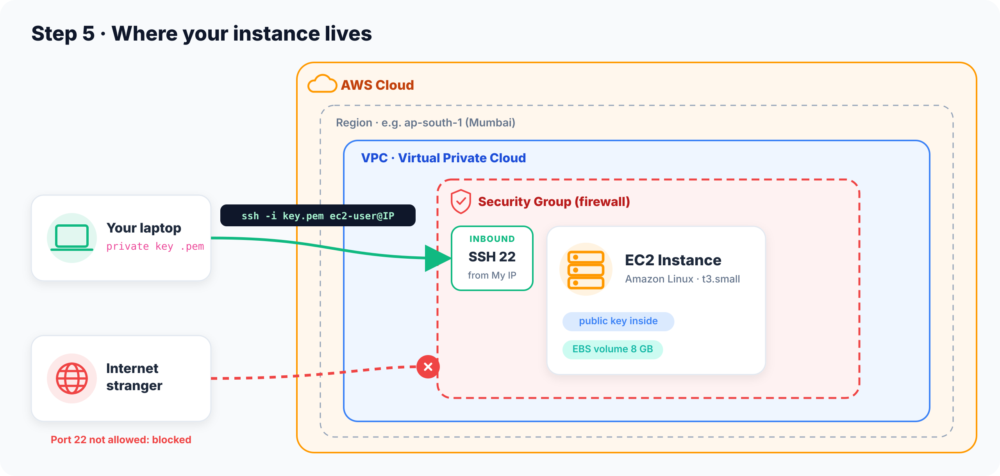

---

## 🧱 Part A: Launching the Instance

### Step 1: Name & Tags

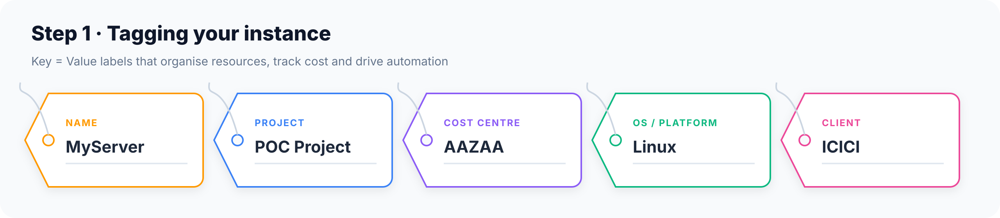

**Tags** are `Key = Value` labels attached to AWS resources. They help with **organisation, cost tracking, automation and access control.**

| Tag Key | Example Value | Why it matters |
|---|---|---|
| `Name` | `MyServer` | Shows up as the instance name in the console |
| `Project` | `POC Project` | Groups resources by project |
| `Cost Centre` | `AAZAA` | Billing and chargeback to the correct department |
| `OS / Platform` | `Windows` / `Linux` | Quick filtering and patching automation |
| `Client ID / Name` | `ICICI` / `ICIC` | Identifies which client the resource belongs to |

> 💡 In companies, tagging is often **mandatory**. Instances without the required tags may be blocked by policy, or even stopped automatically.

---

### Step 2: Choose an AMI (Amazon Machine Image)

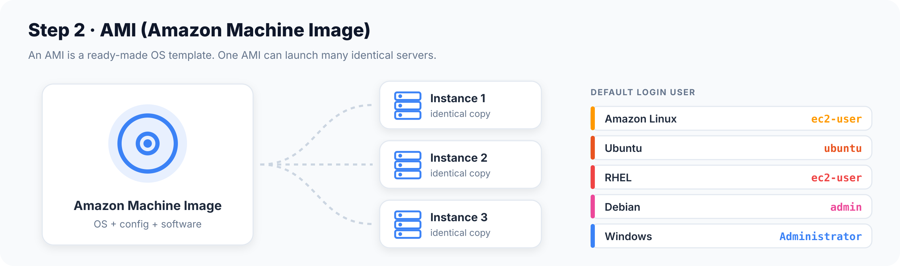

An **AMI** is a **pre-installed, pre-configured operating system template** used to launch an instance. Think of it like a **cookie cutter**: one AMI can stamp out many identical servers.

> ⚠️ The username in your `ssh` command **depends on the AMI**. Using `ec2-user` on Ubuntu will fail.

---

### Step 3: Choose the Instance Type

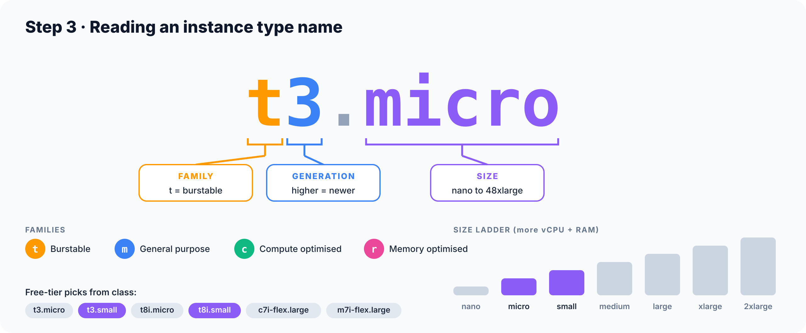

The instance type decides the **CPU, memory and network capacity** of your server.

**Free-account options from class:**

| Instance Type | Notes |
|---|---|
| `t3.micro` | Small labs |
| `t3.small` | ✅ Good choice |
| `t8i.micro` | |
| `t8i.small` | ✅ **Recommended in class** |
| `c7i-flex.large` | Compute-optimised |
| `m7i-flex.large` | General purpose |

> 💡 Which types are free-tier eligible changes over time and by region. Look for the **"Free tier eligible"** badge in the console.

---

### Step 4: Create / Choose a Key Pair

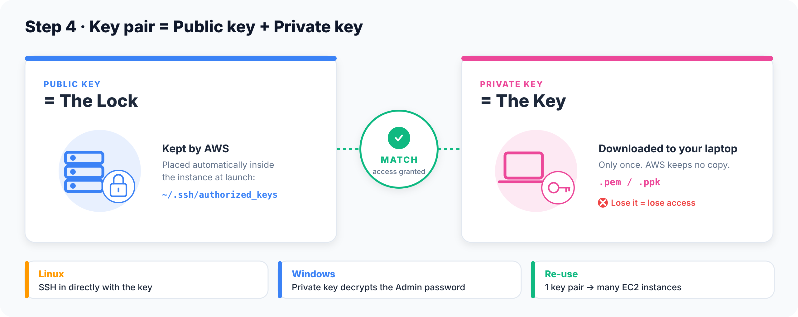

| Component | Analogy | Where it lives |
|---|---|---|
| **Public key** | 🔒 The lock | AWS stores it and automatically places it **inside the EC2 instance** |
| **Private key** | 🗝️ The key | **Downloaded to your laptop** once. AWS doesn't keep a copy |

| OS | How the key is used | Format |
|---|---|---|
| 🐧 **Linux** | Authenticate **directly** via SSH | `.pem` (OpenSSH) or `.ppk` (PuTTY) |
| 🪟 **Windows** | Use the **private key** to **decrypt the Administrator password**, then log in via RDP | `.pem` |

> 📝 `.pem` = *Privacy-Enhanced Mail*, a standard text format for keys and certificates.
> 🔁 **One key pair can be used with many EC2 instances.**
> ⚠️ **If you lose the private key, you lose access.** AWS can't give it back to you.

---

### Step 5: Network Configuration (VPC & Security Groups)

- **VPC (Virtual Private Cloud):** your own isolated network inside AWS.
- **Security Group:** a **virtual firewall**, a set of rules controlling traffic to and from your instance. A rule can allow traffic from **a specific network** (recommended) or **any network** (labs only).

#### 🔢 Ports

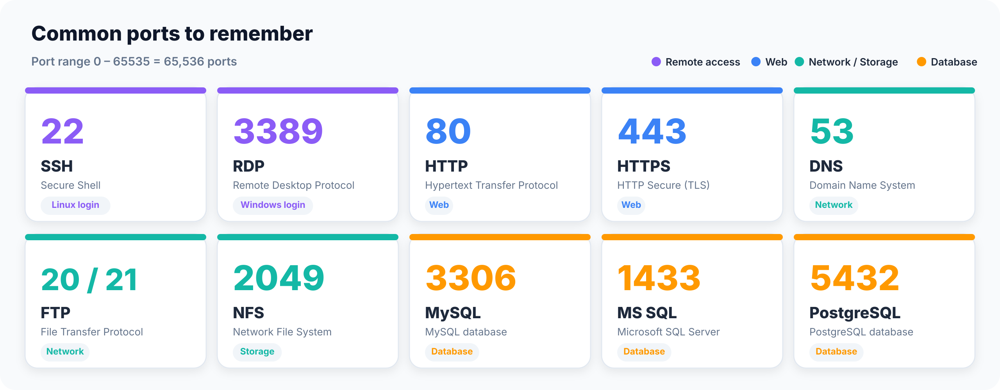

| Service | Full Name | Port |
|---|---|:---:|
| SSH | Secure Shell | `22` |
| RDP | Remote Desktop Protocol | `3389` |
| HTTP | Hypertext Transfer Protocol | `80` |
| HTTPS | HTTP Secure (over TLS) | `443` |
| DNS | Domain Name System | `53` |
| FTP | File Transfer Protocol | `20`, `21` |
| MySQL | | `3306` |
| MS SQL | Microsoft SQL Server | `1433` |
| PostgreSQL | | `5432` |
| NFS | Network File System | `2049` |

> 🧠 **Memory trick:** *"SSH at **22**, RDP at **3389**, Web at **80** / **443**."*

#### 🌐 Who is allowed in?

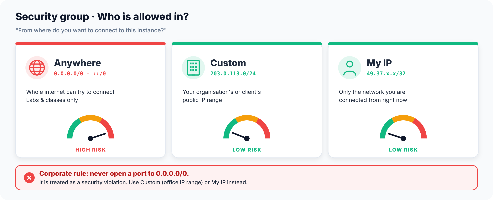

#### 🏢 Real-world requirement

> **"Launch a server that is accessible only to my corporate office users."**
>
> ✅ **Answer:** Inbound rule → `SSH | TCP | 22 | Custom → <corporate public IP range>`

> 🚨 In classes and home labs we use *Anywhere* for convenience. In a corporate environment we **never** open a port to the entire world. It is treated as a **security violation or breach**.

---

### Step 6: Configure Storage

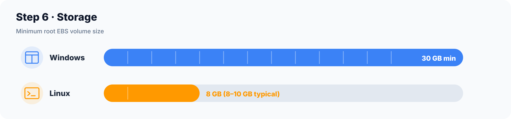

The root disk is an **EBS (Elastic Block Store)** volume, a virtual hard disk attached to the instance.

---

## 🔌 Part B: Connecting to the Instance

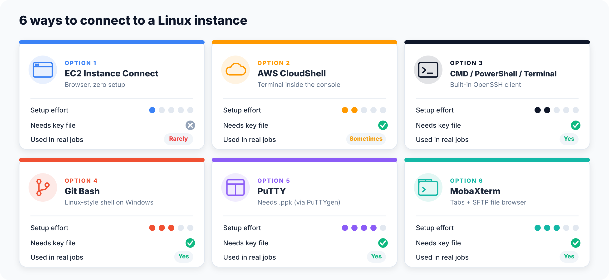

### 🧩 The SSH command (used in options 2, 3 and 4)

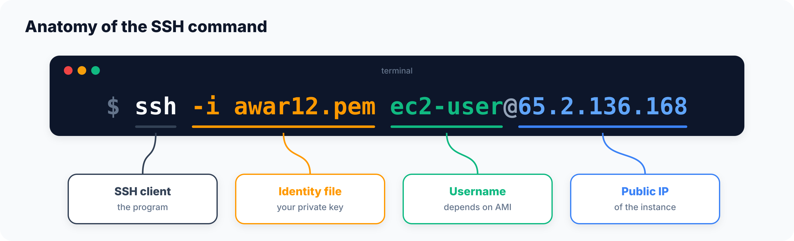

---

### Option 1: Browser-Based (EC2 Instance Connect)

**Steps:** Select instance → **Connect** → **EC2 Instance Connect** tab → **Connect**

- Port 22 must be open to *Anywhere* or to the **AWS-provided IP range** for your region
- Browser **pop-ups must be enabled**

> ⚠️ **We don't use this feature in real environments.**

---

### Option 2: AWS CloudShell

CloudShell is a **Linux terminal built into the AWS Console**.

1. Launch the CloudShell terminal
2. Upload the instance's key pair (**Actions → Upload file**)
3. Restrict the key's permissions
4. Connect with the key

```bash
chmod 400 awar12.pem                     # owner read-only
ssh -i awar12.pem ec2-user@65.2.136.168  # connect
whoami                                   # verify → ec2-user
```

---

### Option 3: Windows CMD / PowerShell or macOS Terminal

**1. Check whether SSH is available:** type `ssh`

| Result | Meaning |
|---|---|
| Shows usage instructions | ✅ Good to go |
| `'ssh' is not recognized...` | ❌ Install the OpenSSH Client |

**2. Install the OpenSSH Client on Windows (if needed):**

```
Settings → System → Optional features → View features
→ Add an optional feature → search "OpenSSH Client"
→ tick it → Next → Install
```
Close and reopen the Command Prompt, then type `ssh` again.

**3. Go to the key folder and connect:**

```cmd
cd C:\path\to\keyfolder
dir
ssh -i awar12.pem ec2-user@65.2.136.168
```

#### 🛠️ Fix "UNPROTECTED PRIVATE KEY FILE" / "Permissions are too open"

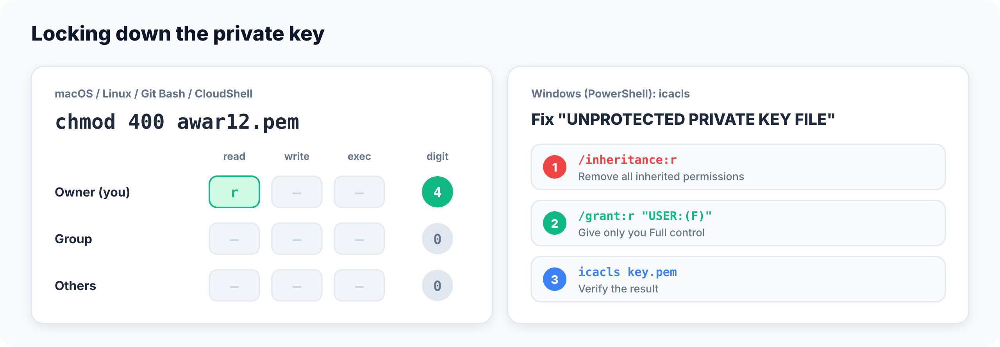

**Windows (PowerShell):** `icacls` = *Integrity Control Access Control Lists*

```powershell
icacls "C:\path\to\awar12.pem" /inheritance:r
icacls "C:\path\to\awar12.pem" /grant:r "$($env:USERNAME):(F)"
icacls "C:\path\to\awar12.pem"
ssh -i awar12.pem ec2-user@65.2.136.168
```

> ℹ️ `$($env:USERNAME)` is **PowerShell** syntax. In CMD, use `%USERNAME%` instead.

**macOS / Linux:** `chmod 400 awar12.pem`

---

### Option 4: Git Bash (Windows & macOS)

1. Install Git from <https://git-scm.com/install>
2. Right-click the folder that holds your key → **"Open Git Bash here"**
3. Run:

```bash
chmod 400 awar12.pem
ssh -i awar12.pem ec2-user@65.2.136.168
```

---

### Option 5: PuTTY

- Website: <https://putty.org> · Download: <https://www.chiark.greenend.org.uk/~sgtatham/putty/latest.html>
- PuTTY needs its own key format, **`.ppk`** (*PuTTY Private Key*). Convert your `.pem` with **PuTTYgen**:

| Step | Where | Action |
|:-:|---|---|
| 1 | PuTTYgen | **Load** the `.pem` → **Save private key** as `.ppk` |
| 2 | PuTTY → Connection → SSH → Auth → Credentials | **Browse** to the `.ppk` |
| 3 | PuTTY → Session | Host: `ec2-user@65.2.136.168`, Port `22` → **Open** |

---

### Option 6: MobaXterm

An all-in-one Windows terminal with **SSH, an SFTP file browser and tabs**.

```
Session → SSH → Remote host: 65.2.136.168
        → Specify username: ec2-user
        → Advanced SSH settings → Use private key → browse .pem → OK
```

---

## 🧯 Troubleshooting Cheat Sheet

| Error / Symptom | Likely Cause | Fix |
|---|---|---|
| `Connection timed out` | Port 22 not open, or wrong IP | Add an inbound rule for SSH 22 from your IP; use the **public** IP |
| `Permission denied (publickey)` | Wrong key or username | Use the attached key; check the AMI's username |
| `UNPROTECTED PRIVATE KEY FILE` | Key permissions too open | `chmod 400` or `icacls` |
| `'ssh' is not recognized` | OpenSSH client missing | Install the OpenSSH Client optional feature |
| Key `No such file or directory` | Wrong folder | `cd` to the key folder; check with `dir` / `ls` |
| IP changed after a restart | Public IPs change on stop/start | Use the new IP, or attach an **Elastic IP** |
| Browser connect fails | Pop-ups blocked / IP range not allowed | Enable pop-ups; allow the EC2 Instance Connect range |

---

## 📝 Quick Revision

1. **Tags** organise resources and track cost.
2. **AMI** = OS template, and it decides the **login username**.
3. **Key pair**: the 🔒 *public* key lives in the instance; you keep the 🗝️ *private* key.
4. **Security Group** = firewall. Linux uses **SSH 22**, Windows uses **RDP 3389**.
5. **Never open `0.0.0.0/0` in production.** Use *Custom* or *My IP*.
6. Lock down the private key with `chmod 400` or `icacls`.
7. **PuTTY needs `.ppk`**. Convert it with **PuTTYgen**.

### 🧪 Self-Check

<details><summary>1. Which port must be open to SSH into Linux?</summary>

**22 (TCP).**
</details>

<details><summary>2. A client wants the server reachable only from their office. Which source do you pick?</summary>

**Custom**, with their public IP range.
</details>

<details><summary>3. What does <code>chmod 400</code> do?</summary>

It makes the file read-only for the owner and gives no access to anyone else.
</details>

<details><summary>4. How do you get the Windows Administrator password?</summary>

Decrypt it in the console using the **private key**.
</details>

<details><summary>5. You have a .pem but want to use PuTTY. What do you do?</summary>

Convert it to **.ppk** with **PuTTYgen**.
</details>
