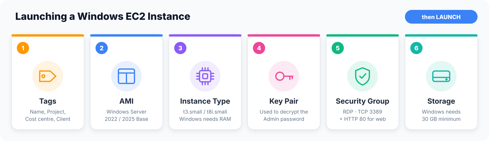
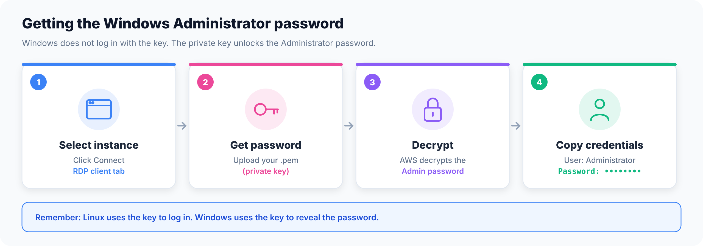
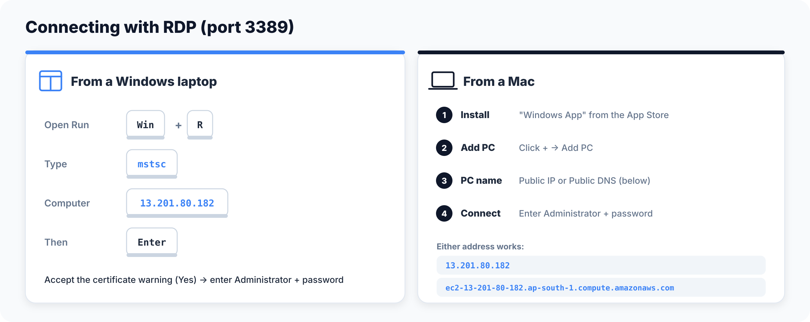
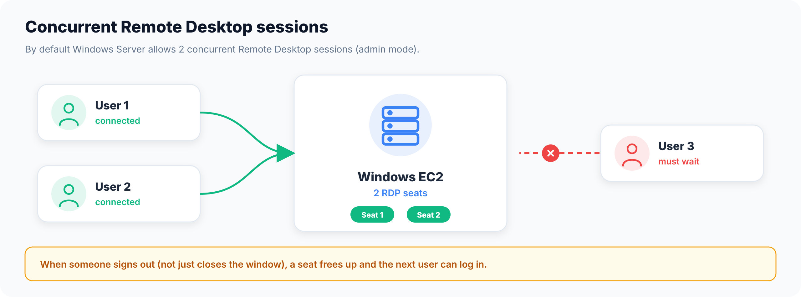
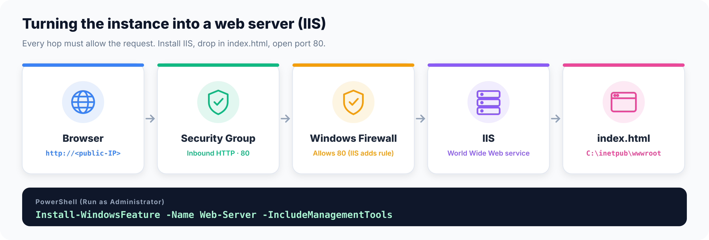
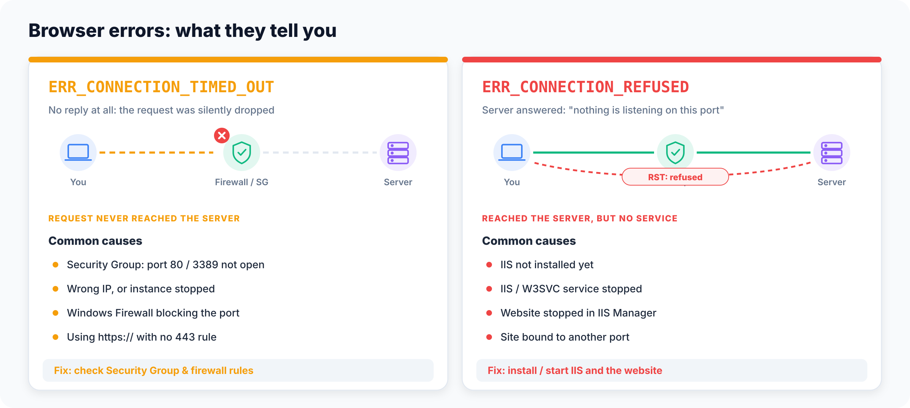
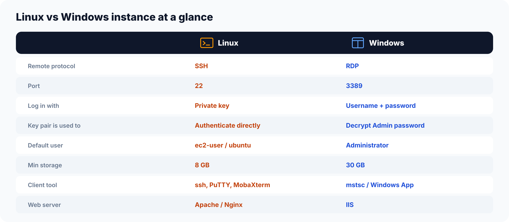

# 🪟 Launch a Windows EC2 Instance, Connect to It & Make It a Web Server

> **Date:** 06/11/2026 · **Track:** AWS Cloud · EC2
> **Goal:** Launch a Windows Server instance, connect to it with Remote Desktop (RDP), and host a test web page with IIS.
>
> 📎 Companion notes: [Linux instance: launch & connect](EC2-Linux-Instance-Launch-and-Connect.md)

---

## 📑 Contents

1. [Launching the Instance](#-1-launching-the-instance)
2. [Getting the Administrator Password](#-2-getting-the-administrator-password)
3. [Connecting with RDP](#-3-connecting-with-rdp)
4. [Managing Local Users (lusrmgr.msc)](#-4-managing-local-users-lusrmgrmsc)
5. [Concurrent RDP Sessions](#-5-concurrent-rdp-sessions)
6. [Making It a Web Server (IIS)](#-6-making-it-a-web-server-iis)
7. [Browser Errors: Timed Out vs Refused](#-7-browser-errors-timed-out-vs-refused)
8. [Linux vs Windows Summary](#-8-linux-vs-windows-summary)

---

## 🧱 1. Launching the Instance



| Step | What to do | Windows-specific notes |
|:-:|---|---|
| 1 | **Add tags** | `Name`, `Project`, `Cost centre`, `OS = Windows`, `Client` |
| 2 | **Choose an AMI** | e.g. *Microsoft Windows Server 2022 / 2025 Base* |
| 3 | **Choose an instance type** | `t3.small` / `t8i.small`. Windows needs more RAM than Linux |
| 4 | **Choose a key pair** | Used to **decrypt the Administrator password**, not to log in |
| 5 | **Configure network (Security Group)** | **RDP · TCP · 3389** (add **HTTP · 80** if it will be a web server) |
| 6 | **Configure storage** | **30 GB minimum** for Windows |

> ⏳ After launch, wait about **4 minutes** before connecting. Windows takes longer to boot and to generate the password, and **Get password** shows "not available yet" until then.

---

## 🔑 2. Getting the Administrator Password



**Console path:** select the instance → **Connect** → **RDP client** tab → **Get password** → **Upload private key file** (`.pem`) → **Decrypt password**

You'll get three things to use in the RDP client:

| Field | Example |
|---|---|
| Public DNS / IP | `13.201.80.182` |
| Username | `Administrator` |
| Password | *(decrypted value)* |

> 💡 You can also click **Download remote desktop file** to get a ready-made `.rdp` shortcut.

---

## 🖥️ 3. Connecting with RDP



### From Windows: built-in *Remote Desktop Connection*

```
Windows + R  →  type: mstsc  →  Enter
Computer: 13.201.80.182  →  Connect
Certificate warning  →  Yes
Username: Administrator  ·  Password: <decrypted password>
```

> `mstsc` = **M**icro**s**oft **T**erminal **S**ervices **C**lient

### From macOS: *Windows App* (formerly *Microsoft Remote Desktop*)

1. Install **Windows App** from the Mac App Store.
2. Click **+ → Add PC**.
3. For **PC name**, enter either address:
   - Public IP: `13.201.80.182`
   - Public DNS: `ec2-13-201-80-182.ap-south-1.compute.amazonaws.com`
4. Connect, then enter `Administrator` and the password.

> 🧩 **Reading the Public DNS:** `ec2-<IP with dashes>.<region>.compute.amazonaws.com`. Here the region `ap-south-1` is Mumbai.

> ⚠️ The public IP **changes when you stop and start** the instance. Attach an **Elastic IP** if you need a fixed address.

---

## 👥 4. Managing Local Users (lusrmgr.msc)

```
Windows + R  →  lusrmgr.msc  →  Enter
```

This opens **Local Users and Groups**, where you create and manage accounts on the server.

| Task | Where |
|---|---|
| Create a new user | **Users** → right-click → **New User…** |
| Reset a password | **Users** → right-click the user → **Set Password…** |
| Allow a user to RDP in | **Groups** → **Remote Desktop Users** → **Add…** the user |
| Give admin rights | **Groups** → **Administrators** → **Add…** the user |

> 🛡️ **Best practice:** give each person their own account instead of sharing `Administrator`. Every login can then be traced to a person.

---

## 🔢 5. Concurrent RDP Sessions



- By default, Windows Server allows **2 concurrent Remote Desktop sessions** (for administration).
- A **3rd user can't log in** until someone **signs out**.
- Just **closing the RDP window only disconnects** the session. It still holds a seat. Use **Start → Sign out** instead.
- More than 2 users at once requires the **RD Session Host** role plus **RDS CALs** (paid licences).

---

## 🌐 6. Making It a Web Server (IIS)



### Step 1: Install IIS

**Option A: PowerShell** (Run as Administrator)

```powershell
Install-WindowsFeature -Name Web-Server -IncludeManagementTools
```

**Option B: Server Manager**

```
Server Manager → Manage → Add Roles and Features → Next (×3)
→ ☑ Web Server (IIS) → Add Features → Next → Install
```

### Step 2: Add your page

Copy [`index.html`](index.html) (the sample test page) into:

```
C:\inetpub\wwwroot\
```

IIS serves `index.html` ahead of its own default page, so you don't need to delete anything.

### Step 3: Open port 80

In the instance's **Security Group**, add an inbound rule: **HTTP · TCP · 80 · My IP** (or Anywhere in labs).

### Step 4: Test

| Where | URL | Proves |
|---|---|---|
| Inside the server | `http://localhost` | IIS is working |
| From your laptop | `http://13.201.80.182` | Security Group + network are working |

> ⚠️ Use **`http://`**, not `https://`. Nothing is listening on port 443 yet.

### Useful IIS commands

```powershell
Get-Service W3SVC          # Is the web service running?
Start-Service W3SVC        # Start it
iisreset                   # Restart IIS
```

---

## 🧯 7. Browser Errors: Timed Out vs Refused



| Error | What happened | Look at |
|---|---|---|
| **`ERR_CONNECTION_TIMED_OUT`** | Request was **silently dropped**. No reply came back. | 🛡️ **Security Group** (port 80 not open), Windows Firewall, wrong IP, instance stopped, using `https://` |
| **`ERR_CONNECTION_REFUSED`** | Request **reached the server**, but **nothing is listening** on that port | 🖥️ **IIS** not installed, the `W3SVC` service stopped, website stopped in IIS Manager, wrong port binding |

> 🧠 **Memory trick:**
> - **Timed out** = *"the door is locked and nobody answers"* → check the **firewall / Security Group**.
> - **Refused** = *"someone opened the door and said no one lives here"* → check the **service (IIS)**.

The same logic applies to RDP. If `mstsc` can't connect at all, check that **port 3389** is open in the Security Group.

---

## ⚖️ 8. Linux vs Windows Summary



---

## 📝 Quick Revision

1. Windows uses **RDP on port 3389**. Open it to **My IP / office IP**, never to the world in production.
2. The **key pair decrypts the Administrator password**. You log in with a username and password.
3. Use **`mstsc`** on Windows and **Windows App** on Mac. Connect with the **public IP or public DNS**.
4. **`lusrmgr.msc`** manages local users and groups. Add users to **Remote Desktop Users** so they can RDP in.
5. Windows allows **2 concurrent RDP sessions** by default. **Sign out** to free a seat.
6. To make a web server: **install IIS** → put files in **`C:\inetpub\wwwroot`** → **open port 80**.
7. **Timed out = firewall/SG problem · Refused = service problem.**

### 🧪 Self-Check

<details><summary>1. Which port must be open to RDP into Windows?</summary>

**3389 (TCP).**
</details>

<details><summary>2. What do you need to get the Administrator password?</summary>

The **private key (.pem)** of the key pair used at launch.
</details>

<details><summary>3. A third person can't RDP in even though the password is right. Why?</summary>

Two sessions are already in use. Someone must **sign out**, not just close the window.
</details>

<details><summary>4. The browser shows ERR_CONNECTION_REFUSED. Firewall or IIS?</summary>

**IIS / the service.** The request reached the server, but nothing was listening.
</details>

<details><summary>5. Where does IIS look for website files by default?</summary>

`C:\inetpub\wwwroot`
</details>
