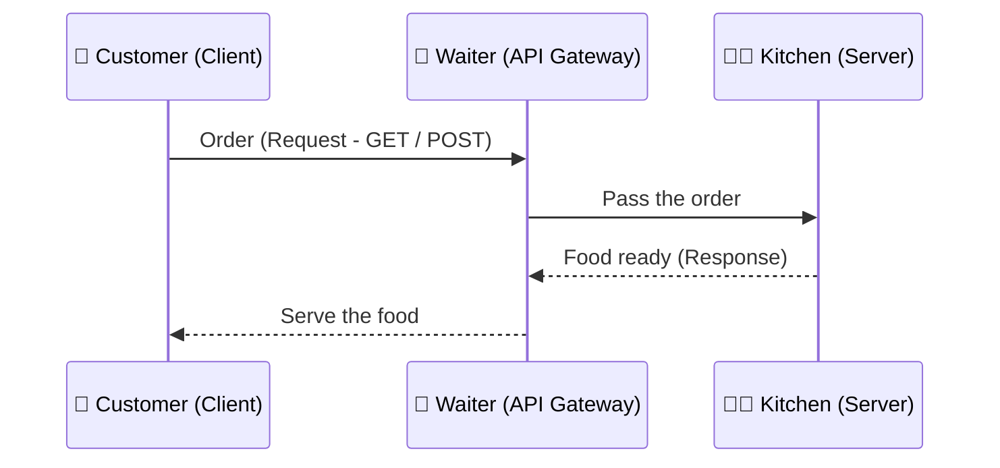
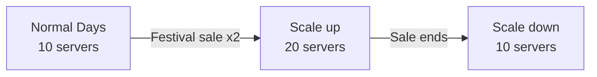
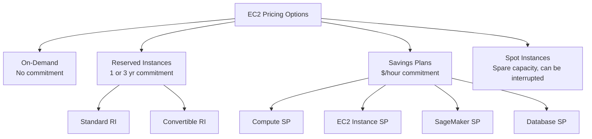
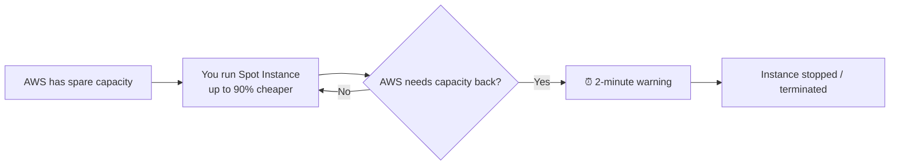
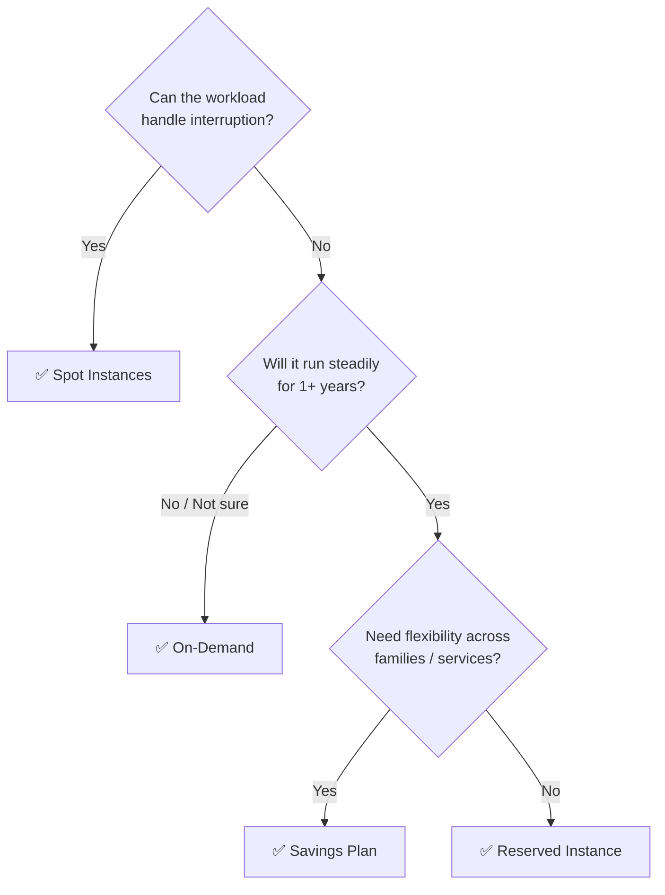

# Amazon EC2 – Elastic Compute Cloud

> **One-line definition:** Amazon EC2 lets us **rent a virtual server from AWS in minutes**. We choose how much CPU, memory and storage we need, and we can **start, use, stop and delete** it whenever we want.

---

## 1. Client–Server Basics

| Term | Definition |
|---|---|
| **Client** | The one who **sends a request** (browser, mobile app, another program) |
| **Server** | The machine that **processes the request and sends back a response** |
| **API / API Gateway** | The **middle layer** that takes requests from the client, passes them to the server and brings the response back |

### 🍽️ Restaurant Analogy

| Restaurant | Computing World |
|---|---|
| Customer | **Client** |
| Waiter | **API Gateway** (carries the request & response) |
| Kitchen | **Server** |
| Order ("1 pizza") | **Request** |
| Food delivered | **Response** |



**Common HTTP methods (the "type of order"):**

| Method | Purpose | Example |
|---|---|---|
| `GET` | Read / fetch data | View menu |
| `POST` | Create new data | Place a new order |
| `PUT` | Replace existing data fully | Replace the whole order |
| `PATCH` | Update part of the data | Change only the drink |
| `DELETE` | Remove data | Cancel the order |

---

## 2. Why the Cloud? Old Way vs EC2

### Old Way – Physical Servers in Your Own Data Center
You had to buy and manage everything yourself:
- 🏢 Data center space
- 🔌 Power connection & **UPS** (backup power)
- ❄️ Cooling
- 🔧 Hardware maintenance
- 🔒 Physical security

👉 This means a lot of **CAPEX (Capital Expenditure)** – big upfront money spent on hardware.

### 🎉 The Festival Sale Problem

| Day | Traffic | Servers Needed |
|---|---|---|
| Normal days | x1 | 10 servers |
| Festival sale | **x2** | **20 servers** |

**Old way:** buy 20 physical servers → 10 sit **idle** for most of the year 💸
**EC2 way:** run 10 servers normally → **add 10 more only during the festival** → remove them after ✅



### Comparison

| | On-Premises (Old) | Amazon EC2 (Cloud) |
|---|---|---|
| Cost type | **CAPEX** – upfront purchase | **OPEX** – pay monthly for usage |
| Setup time | Weeks / months | **Minutes** |
| Scaling | Buy more hardware | Click / automate |
| Maintenance | Your team | AWS |
| Idle capacity | Wasted money | Stop / delete it |

> **Pay-as-you-go:** You pay only for the resources you actually use. Example: use a server for **1 hour → pay for 1 hour only**.

---

## 3. Same Thing, Different Names

| AWS | Azure | Google Cloud | General Term |
|---|---|---|---|
| **EC2 Instance** | Virtual Machine (VM) | Compute Engine (VM instance) | **Server** |

> In AWS, a **server = an instance**.

---

## 4. EC2 Pricing (Purchasing) Options



### 4.1 On-Demand Instances

> **Definition:** Pay for compute **per second / per hour** only while the instance is running. **No upfront payment, no long-term commitment.**

**✅ Best for:**
- Testing with a wide variety of configurations
- Dev / QA environments
- Short-term or unpredictable workloads

**❌ Cons:**
- **Most expensive** option per hour
- Costly if running **24/7 for the whole month**

---

### 4.2 Reserved Instances (RIs)

> **Definition:** Commit to AWS for **1 year or 3 years** and get a big discount compared to On-Demand — **up to 72%**.

#### Two Types of RIs

| | Standard RI | Convertible RI |
|---|---|---|
| Discount | **Biggest** (up to 72%) | Smaller |
| Change instance family? | ❌ No | ✅ Yes |
| What can be changed? | AZ, instance size (within the same family) | Family, OS, tenancy & more (exchange for another Convertible RI) |
| Best for | Steady, predictable workloads | Workloads that may change over time |

#### Three Payment Options

| Option | How You Pay | Discount |
|---|---|---|
| **All Upfront** | Pay everything at the start | 🥇 Highest |
| **Partial Upfront** | Pay some now + the rest at a discounted hourly rate | 🥈 Medium |
| **No Upfront** | Pay hourly through the term (still committed for 1/3 years) | 🥉 Lowest |

> 💡 **AWS Marketplace (RI Marketplace):** You can register as a seller and **sell your unused Reserved Instance capacity** to others.

---

### 4.3 Spot Instances

> **Definition:** Use AWS's **spare (unused) capacity** at a huge discount — **up to 90%** off On-Demand. **No commitment.**

⚠️ **Catch:** When AWS needs the capacity back, it can **stop or terminate** your instance with only a **2-minute warning**.



**✅ Best for (workloads that can handle interruption):**
- Batch jobs
- Data processing / big data
- Video rendering
- ML training needing high configuration at low cost

**❌ Not for:** Databases, production web servers, anything that must not stop.

> 💡 Check **Spot pricing history** before launching to understand price trends. (You can optionally set a maximum price you're willing to pay.)

---

### 4.4 Savings Plans

> **Definition:** A modern, simpler alternative to RIs. You commit to spend a **fixed amount per hour ($/hour) on compute for 1 or 3 years**, and AWS gives a discount on that usage.

**Example:** "I commit to spend **$10/hour** on compute for 1 year" → anything up to $10/hour is charged at the discounted rate; anything above is charged at the On-Demand rate.

| Savings Plan Type | Applies To | Flexibility |
|---|---|---|
| **Compute Savings Plan** | EC2, Lambda, Fargate | 🟢 Most flexible – any family, size, region, OS |
| **EC2 Instance Savings Plan** | EC2 only – a specific instance family in a specific region | 🟡 Less flexible, bigger discount |
| **SageMaker Savings Plan** | SageMaker (AI/ML workloads) | ML only |
| **Database Savings Plan** | Database workloads (e.g. RDS, ElastiCache) | Database only |

---

### 4.5 Pricing Options – Quick Comparison

| Option | Commitment | Max Discount | Can Be Interrupted? | Best For |
|---|---|---|---|---|
| **On-Demand** | None | 0% | No | Dev/QA, short-term, unpredictable |
| **Reserved Instances** | 1 or 3 yrs | Up to 72% | No | Steady 24/7 workloads |
| **Savings Plans** | 1 or 3 yrs ($/hr) | Up to 72% | No | Steady usage, needs flexibility |
| **Spot** | None | Up to 90% | **Yes (2-min warning)** | Batch, big data, ML training |

### 🧠 Which One Should I Pick?



---

## 5. Instance Families (Instance Types)

| Family | What It Means | Letters | Use Cases |
|---|---|---|---|
| **General Purpose** | Balanced CPU + memory + network | **T, M** | Web servers, small apps, dev/test |
| **Compute Optimized** | More CPU power | **C** | Batch processing, gaming servers, high-performance web servers |
| **Memory Optimized** | Lots of RAM – data lives in memory | **R, U, X, Z** | In-memory databases, caching, real-time analytics |
| **Storage Optimized** | High IOPS / throughput on local storage | **I, D, H** | Data warehouses, big data, high-I/O databases |
| **Accelerated Computing** | GPU / special hardware | **P, G, Trn** | ML training, graphics, video processing |
| **High-Performance Computing** | Built for HPC workloads | **Hpc** | Scientific simulations, weather modelling |

> 🧠 **Memory trick:** **T/M** = Typical/Main · **C** = CPU · **R** = RAM · **I** = I/O · **P/G** = Processing/GPU

---

## 6. Reading an Instance Type Name

**Example:** `t8i.micro`

```
   t    8    i   .  micro
   │    │    │       │
   │    │    │       └── Size        → amount of CPU & memory
   │    │    └────────── Processor   → i = Intel
   │    └─────────────── Generation  → higher = newer, better price/performance
   └──────────────────── Family      → t = General Purpose (burstable)
```

| Part | Value | Meaning |
|---|---|---|
| **Family** | `t` | Instance family (General Purpose) |
| **Generation** | `8` | Higher generation = **better performance with better pricing** |
| **Processor / Attribute** | `i` | Intel processor |
| **Size** | `.micro` | How much CPU & memory |

### Processor Letters

| Letter | Processor |
|---|---|
| `i` | Intel |
| `a` | AMD |
| `g` | AWS **Graviton** (ARM-based, AWS's own chip) |

### Sizes (Small → Large)

```
nano → micro → small → medium → large → xlarge → 2xlarge → 4xlarge → ... → 18xlarge → ...
```

| Size | Relative Power |
|---|---|
| `.nano` / `.micro` | Tiny – testing, learning |
| `.small` / `.medium` | Small apps |
| `.large` / `.xlarge` | Standard workloads |
| `.2xlarge` and above | Heavy workloads (each step ≈ **double** the previous) |

---

## 7. Key Terms Glossary

| Term | Definition |
|---|---|
| **EC2** | Elastic Compute Cloud – AWS service to rent virtual servers |
| **Instance** | A virtual server running in EC2 |
| **CAPEX** | Capital Expenditure – large upfront spending on hardware |
| **OPEX** | Operational Expenditure – ongoing pay-for-what-you-use spending |
| **Pay-as-you-go** | Pay only for what you actually use |
| **On-Demand** | No commitment, pay per second/hour |
| **Reserved Instance (RI)** | 1/3-year commitment for a discount |
| **Savings Plan** | 1/3-year $/hour spend commitment for a discount |
| **Spot Instance** | Spare AWS capacity at up to 90% off, can be interrupted |
| **AZ** | Availability Zone – one or more data centers inside a region |
| **Tenancy** | Whether your instance runs on shared or dedicated hardware |
| **IOPS** | Input/Output Operations Per Second – a storage speed measure |
| **Graviton** | AWS's own ARM-based processor – usually better price/performance |
