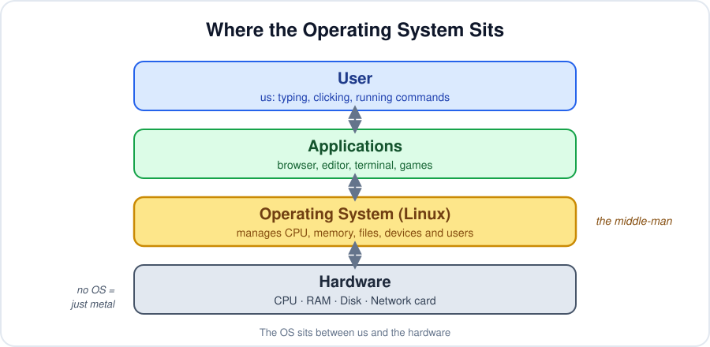
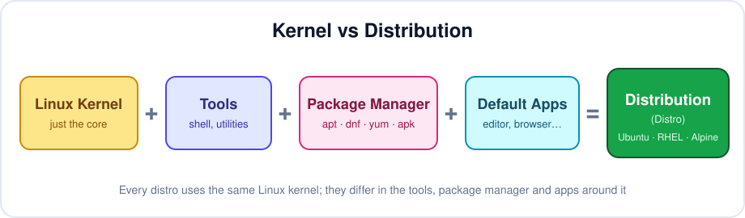
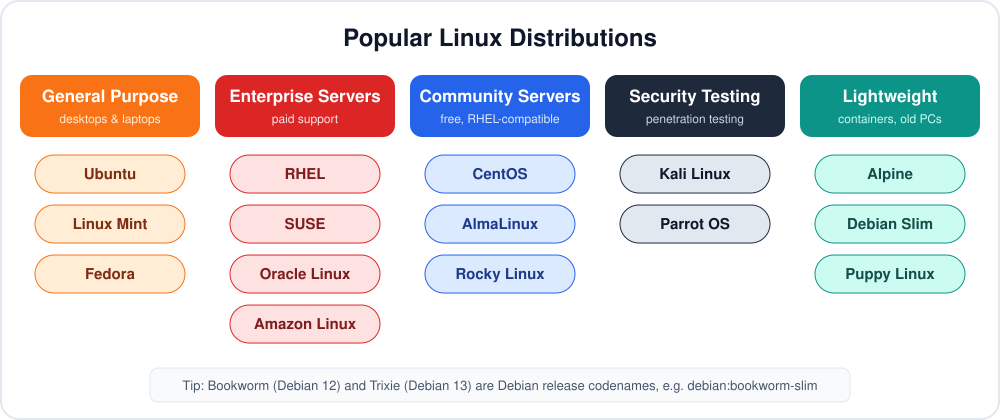
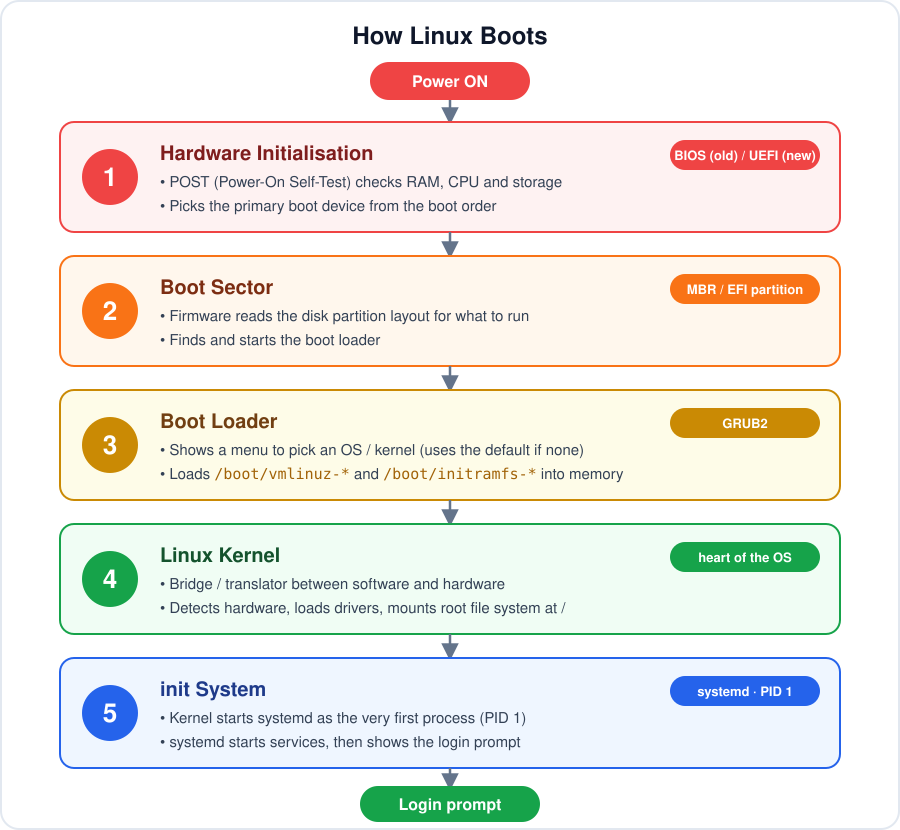
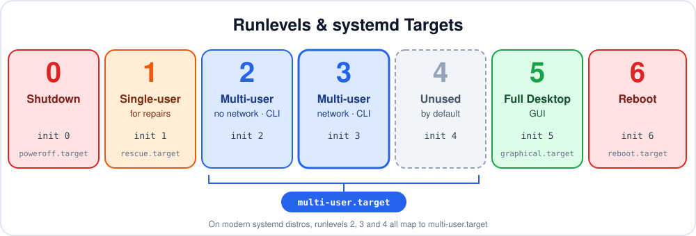
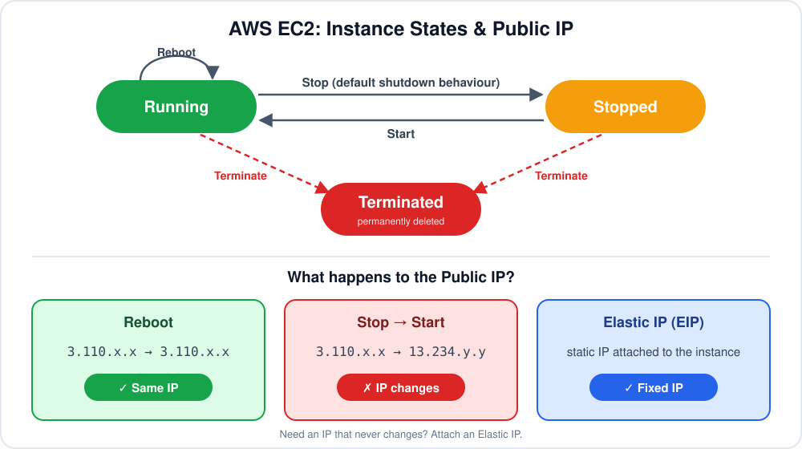
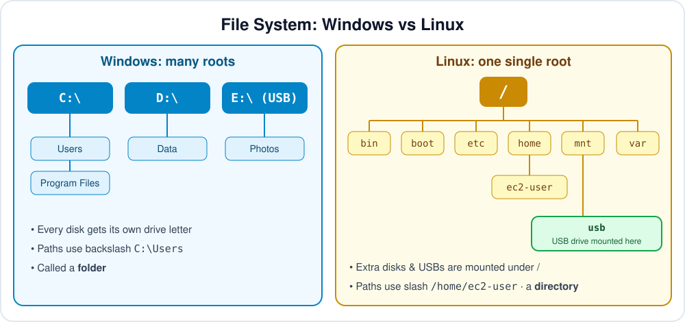
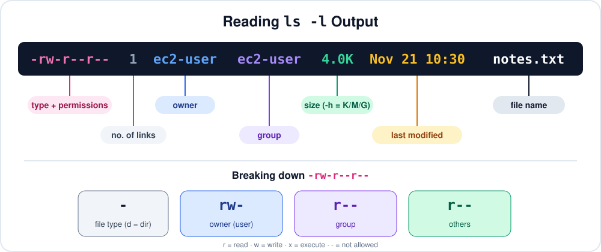

<div align="center">

# 🐧 Linux Notes

**My notes from learning Linux: the basics, the boot process, runlevels, EC2 behaviour and the first commands**


</div>

---

## 📑 Table of Contents

| # | Topic |
|---|-------|
| 1 | [What is Linux?](#1-what-is-linux) |
| 2 | [What is an Operating System?](#2-what-is-an-operating-system) |
| 3 | [Why Linux?](#3-why-linux) |
| 4 | [Kernel vs Distribution](#4-kernel-vs-distribution) |
| 5 | [Popular Linux Distributions](#5-popular-linux-distributions) |
| 6 | [How Linux Boots](#6-how-linux-boots) |
| 7 | [Runlevels & systemd Targets](#7-runlevels--systemd-targets) |
| 8 | [AWS EC2: Shutdown Behaviour & IP Addresses](#8-aws-ec2-shutdown-behaviour--ip-addresses) |
| 9 | [Linux File System vs Windows](#9-linux-file-system-vs-windows) |
| 10 | [Basic Commands](#10-basic-commands) |
| 11 | [Quick Revision Cheat Sheet](#11-quick-revision-cheat-sheet) |

---

## 1. What is Linux?

> **Linux** is a **free, open-source operating system** based on **Unix**.
> It was created by **Linus Torvalds**, and the first release came out in **1991**.

| OS | Linux-based? | Kernel |
|----|:------------:|--------|
| 🤖 Android | ✅ Yes | Linux kernel |
| 🍎 iOS / macOS | ❌ No | Darwin / XNU (a Unix-style kernel) |

---

## 2. What is an Operating System?

An **operating system (OS)** is software that sits **between us and the hardware**.

<p align="center">
  
</p>

> 💡 Without an operating system, a computer is **just metal**: a device that can't do anything useful.

---

## 3. Why Linux?

| Benefit | Description |
|---------|-------------|
| 💰 **Free** | No licensing cost for most versions |
| 🔒 **Secure** | Strong permission model |
| 🧱 **Stable** | Can run for years without a reboot |
| ⚡ **Fast** | Runs even on very minimal hardware |
| 🤝 **Community** | Thousands of contributors worldwide |

---

## 4. Kernel vs Distribution

- The **Linux Kernel** is just the **core** of the OS.
- A **Distro (Distribution)** is the full package built around that core.

<p align="center">
  
</p>

---

## 5. Popular Linux Distributions

<p align="center">
  
</p>

| Category | Distributions |
|----------|---------------|
| 🖥️ **General purpose** | Ubuntu, Linux Mint, Fedora |
| 🏢 **Enterprise servers** | RHEL (Red Hat Enterprise Linux), SUSE, Oracle Linux, Amazon Linux |
| 🌐 **Community servers** | CentOS, AlmaLinux, Rocky Linux |
| 🛡️ **Security / penetration testing** | Kali Linux, Parrot OS |
| 🪶 **Lightweight / containers** | Alpine, Debian Slim, Puppy Linux |

---

## 6. How Linux Boots

<p align="center">
  
</p>

<details>
<summary><b>📖 Click to expand: step-by-step details</b></summary>

### Step 1: Hardware Initialisation (BIOS = old, UEFI = new)
- **POST (Power-On Self-Test)** checks critical hardware like **RAM, CPU, and storage**.
- Picks the **primary boot device** based on the **boot order**.

### Step 2: Boot Sector (MBR / EFI Partition)
- Firmware looks at the **disk partition layout** for instructions on what to run.
- It **finds and starts the boot loader**.

### Step 3: Boot Loader (GRUB2)
- Shows a **menu** to choose an OS or kernel version (picks the **default** if we don't choose).
- Loads these files into memory:
  - `/boot/vmlinuz-*`: the compressed Linux kernel
  - `/boot/initramfs-*`: a temporary root file system used during boot

### Step 4: Linux Kernel (the heart of the OS)
- Acts as a **translator / bridge** between software applications and physical hardware.
- **Detects hardware**, **loads drivers**, and **mounts the root file system** at `/`.

### Step 5: init System (systemd)
- The kernel starts **systemd** as the **very first process**, with **PID 1**.
- systemd starts services, and finally we get a **login prompt** to enter our credentials.

</details>

> 🧠 **Memory trick:** **B**oys **B**ring **G**ood **K**ites **S**unday → **B**IOS → **B**oot sector → **G**RUB → **K**ernel → **S**ystemd

---

## 7. Runlevels & systemd Targets

A **runlevel** tells Linux **which mode it should run in**.

<p align="center">
  
</p>

### Commands

```bash
# Check the current runlevel
runlevel
who -r

# Check the default systemd target
systemctl get-default

# Set the default target to CLI mode (multi-user)
sudo systemctl set-default multi-user.target

# Set the default target to GUI mode
sudo systemctl set-default graphical.target
```

---

## 8. AWS EC2: Shutdown Behaviour & IP Addresses

In EC2, the **default shutdown behaviour is `stop`**. The two options are **Stop** (can be started again) and **Terminate** (permanently deleted).

<p align="center">
  
</p>

| Action | Public IP |
|--------|:---------:|
| 🔄 **Reboot** | ✅ Stays the same |
| 🛑 **Stop → Start** | ❌ Changes |
| 📌 **With Elastic IP (EIP)** | ✅ Fixed |

---

## 9. Linux File System vs Windows

<p align="center">
  
</p>

| Windows | Linux |
|---------|-------|
| Starts from drives like `C:\` or `D:\` | Starts from **one single root**: `/` |
| Extra disks get new drive letters | Extra disks and USB drives are **mounted as directories under `/`** |
| **Folder** | **Directory** |

### Common top-level directories

| Directory | What lives there |
|-----------|------------------|
| `/bin` | Essential user commands (`ls`, `cat`) |
| `/boot` | Kernel and boot loader files (`vmlinuz`, `initramfs`) |
| `/etc` | System configuration files |
| `/home` | Home directories of normal users |
| `/root` | Home directory of the root user |
| `/mnt` | Mount point for extra disks / USB drives |
| `/tmp` | Temporary files |
| `/var` | Variable data such as logs (`/var/log`) |

---

## 10. Basic Commands

### 📂 Navigation

| Command | Description |
|---------|-------------|
| `pwd` | **P**rint **W**orking **D**irectory: shows where you are |
| `cd <dir>` | **C**hange **D**irectory |
| `cd /` | Go to the root directory |
| `cd ..` | Go **one step back** (up one level) from the current path |
| `cd ~` or `cd` | Go to your home directory |

### 📋 Listing Files

| Command | Description |
|---------|-------------|
| `ls` | List files and directories |
| `ls -a` | List **everything**, including hidden files (names starting with `.`) |
| `ls -l` | **Long list**: permissions, owner, size, date |
| `ls -lh` | Long list with sizes in **human-readable** format (K, M, G) |
| `ls -ltr` | Long list sorted by **time**, **reversed**: oldest first, newest last |

<p align="center">
  
</p>

### 📄 Viewing File Content

| Command | Description |
|---------|-------------|
| `cat <file>` | Prints the **whole file** at once (best for small files) |
| `more <file>` | Shows the file **page by page** (`Space` = next page, `q` = quit) |

### 👤 User Info & Switching Users

| Command | Description |
|---------|-------------|
| `whoami` | Shows **which user** you are currently working as |
| `sudo su` | Switches to the **root user** (superuser) using `sudo` privileges |
| `exit` | Leave the root shell and return to your normal user |

> ⚠️ Be careful as **root**: it can change or delete anything. The prompt usually changes from `$` (normal user) to `#` (root).

### 🧪 Try it yourself

```bash
pwd              # /home/ec2-user
cd /             # move to root
ls -lh           # long list, human-readable sizes
ls -a            # include hidden files
ls -ltr          # newest files at the bottom
cat notes.txt    # print file content
more notes.txt   # read file page by page
whoami           # ec2-user
sudo su          # become root
whoami           # root
exit             # back to ec2-user
```

---

## 11. Quick Revision Cheat Sheet

<table>
<tr>
<td valign="top">

**🧠 Concepts**
- Linux = free, open-source, Unix-based
- Linus Torvalds, 1991
- Kernel = core
- Distro = kernel + tools + package manager + apps
- systemd = PID 1

</td>
<td valign="top">

**🔁 Boot order**
1. BIOS / UEFI (POST)
2. MBR / EFI
3. GRUB2
4. Kernel
5. systemd → login

</td>
<td valign="top">

**☁️ EC2**
- Default shutdown = **stop**
- Reboot → same IP
- Stop/Start → new IP
- Fixed IP → **Elastic IP**

</td>
</tr>
<tr>
<td valign="top">

**🎚️ Runlevels**
- `0` shutdown
- `1` rescue
- `3` CLI
- `5` GUI
- `6` reboot

</td>
<td valign="top">

**📂 Navigation**
- `pwd`
- `cd /`, `cd ..`, `cd ~`
- `ls -a`, `-l`, `-lh`, `-ltr`

</td>
<td valign="top">

**📄 Files & users**
- `cat`, `more`
- `whoami`
- `sudo su`, `exit`

</td>
</tr>
</table>

---

<div align="center">

⭐ *More notes coming as I keep learning!* ⭐

</div>
